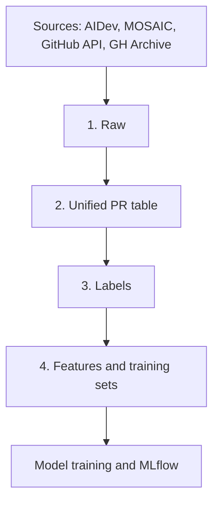

# Riffle for Maintainers: Data Management Plan

**Status:** Draft v0.1 for team review **Scope:** How we collect, store, version, validate, label and share data across the project lifecycle **Audience:** All workstream owners

---

## 1. Purpose

Riffle predicts how an AI-agent-authored pull request (PR) will end up, so open-source maintainers can spend review time where it counts. Everything downstream (the model, the drift monitor, the retraining loop, the Expo numbers) depends on the data being correct, reproducible and free of leakage. This document sets the rules every workstream follows.

Three goals drive the design:

1. **Reproducibility.** For any model in any environment, we can say exactly which data trained it.
2. **No leakage.** The model only ever sees information that was available when the PR was opened.
3. **Fresh data for drift.** A daily 2026 collection job runs for as long as possible before the Expo, because PRs captured late cannot be reconstructed as they looked when opened.

---

## 2. Data sources

| Source | Role | Notes |
| --- | --- | --- |
| AIDev (Hugging Face `hao-li/AIDev`) | Backbone for 2025 agent PRs | Pin a specific revision tag. v3 has the richest tables (timeline, issues, task types); v4 has the most volume and Jules. Confirm table availability in week 1. |
| MOSAIC-agentic-3m | Extra Claude Code and Jules depth, same-window human baseline | Confirm licence before use. |
| Hand-labelled rejection sets (Ehsani et al., Peralta et al., and similar) | Seed the label taxonomy and validate our labeller | Small (hundreds of PRs each). Not for training. |
| GitHub API (GraphQL and REST) | Hydration: contributor status, CI state, timestamps, merger | Source of truth for anything AIDev lacks. |
| GH Archive / BigQuery | Discovery index for new 2026 agent PRs | Since late 2025 the event payloads are trimmed, so treat it as a way to find candidates, not as a source of PR detail. Verify 2026 coverage in week 1. |
| Human-PR datasets (DupPR, stale-bot set, "On the Shoulders of Giants") | Baselines and a duplicate-similarity feature | Optional, lower priority. |

**Known gaps no source fills:** outside-contributor flags, six-class outcome labels at scale, CI status, model versions, and 2026 coverage. The plan below addresses the first four through hydration, our own labeller and validation set; the fifth through our daily collection job. Model versions are not available, so drift is monitored on agent mix, detection method, text and diff embeddings, and time.

---

## 3. Architecture: four layers

### Layer 1: Raw

- **Contents:** the pinned AIDev and MOSAIC downloads, the published hand-labelled sets, and every GitHub API response saved as raw JSON with a `fetched_at` timestamp.
- **Rule:** immutable and append-only. Nobody edits or deletes files here. A re-fetch of the same PR creates a new record.
- **Why:** when we find a bug in a later layer, we rebuild from raw instead of re-collecting.

### Layer 2: Unified PR table

One clean row per PR, merged across sources and de-duplicated.

- **Snapshot at open time:** title, body, files changed, diff stats, linked issue, detected agent.
- **Contributor fields:** see section 4.
- **Outcome timestamps:** merged, closed, last maintainer activity.
- **Provenance:** which source(s) the row came from and which signal detected the agent (`detection_method`), so we can monitor drift in detection itself.

The schema is defined in week 1 and lives in the repo (see section 8).

### Layer 3: Labels

A separate table, never mixed into the PR table.

| Column | Meaning |
| --- | --- |
| `pr_id` | `repo_full_name#number` |
| `outcome_class` | One of the classes in section 5 |
| `labeller_version` | Version of the rules that produced the label |
| `label_final_at` | When the outcome became final |
| `source` | `rules` or `gold` (hand-labelled) |

Keeping labels separate lets us improve the labelling rules and compare versions without touching anything else. The hand-labelled validation set lives here as `gold`.

### Layer 4: Features and training sets

A **training set** is a fixed combination of three versions: a features version, a labels version, and a time cutoff for the train/test split. Each gets a name, for example:

`train_v3 = features v2 + labels v4 + cutoff 2026-03-01`

Any experiment can then be reproduced exactly.

---

## 4. Defining "outside contributor"

The model is trained only on PRs from outside contributors. Otherwise it learns the shortcut that a developer merging their own agent's work is almost always accepted, and published accuracy numbers on unfiltered data are inflated for this reason.

We use three GitHub signals, fetched together via GraphQL (`authorAssociation`, `isCrossRepository`, `author`, `mergedBy`).

**Strict rule (primary).** A PR counts as outside-contributor if all hold:

1. `authorAssociation` is one of `CONTRIBUTOR`, `FIRST_TIME_CONTRIBUTOR`, `FIRST_TIMER`, `NONE`.
2. `isCrossRepository` is true (the PR came from a fork).
3. If merged, it was not merged by its author.

**Loose rule (reported alongside).** Rules 1 and 3 only. Reporting both shows how sensitive results are to the definition.

**Known traps:**

- `authorAssociation` may reflect the time of the query, not the time the PR was opened (verify on a sample). If so, reconstruct status from history instead: before this PR's creation date, had the author ever merged, closed or labelled PRs in that repo? If yes, treat them as a maintainer at that time.
- Copilot and Devin PRs are opened by bot accounts, usually on behalf of repo insiders. The bot's association says nothing; the human who assigned the task matters. Expect most of these to drop out.
- `CONTRIBUTOR` is a grey zone. The history check above catches contributors who are effectively maintainers.

**Week 1-2 go/no-go.** Hydrate a random 1,000 AIDev PRs and report the share passing the strict and loose rules, per agent. See section 10 for what each outcome means.

---

## 5. Labels

Draft outcome classes (to be finalised after the week 4 validation):

| Class | Draft rule |
| --- | --- |
| Merged unchanged | Merged, no changes requested, no commits after open |
| Merged after rework | Merged, with `CHANGES_REQUESTED` or commits/force-pushes after open |
| Closed as duplicate | `marked_as_duplicate` event, or maintainer comment such as "duplicate of #", "superseded by" |
| Closed as unwanted | Maintainer comment classifier seeded from published rejection taxonomies |
| Abandoned | No human, non-author response before close, or open 60+ days with no response |
| Closed after CI failure | Failing required check at close and no substantive maintainer objection |

**Expect noise.** In published studies, roughly a third of rejections have no observable rationale. We keep an explicit `unknown / closed silently` bucket or fold it into abandoned, and we report label quality honestly.

**Validation.** Two annotators hand-label 300 to 500 filtered PRs using the published taxonomy. We report Cohen's kappa between annotators and per-class precision of the rules against `gold`.

**Collapsing classes.** If a class has fewer than about 200 examples after filtering, merge it into a neighbour (for example, fold CI failure into "closed: other technical"). If the outside-contributor slice is thin, reduce to three classes: likely merge, likely needs rework, likely to go nowhere.

**Label maturity.** Only label a PR once it is closed (ideally 14+ days ago) or has been open long enough to count as abandoned. Labelling recent open PRs produces fake "abandoned" labels.

---

## 6. Three rules that prevent the classic mistakes

### 6.1 Point-in-time correctness

A feature may only use information knowable at the PR's creation time. Repo-level statistics, such as the historical merge rate for outside PRs, must be computed only from PRs closed before the target PR was created.

**Excluded from features:** counts of reviews, comments or commits after open, `closed_at`, and any label applied after open. An optional "t+CI" second-stage model may use CI status measured at a defined delay after open.

This is enforced by an automated check: any feature whose source timestamp is later than the PR's creation time fails the pipeline.

### 6.2 Capture live PRs when they open

The GitHub API returns a PR's current state, not its original state. Titles get edited and contributor status changes. For the 2026 collection we poll at least daily and store a snapshot of each new PR soon after it opens. A PR fetched weeks later is not the PR the model would have seen.

### 6.3 Time-ordered splits only

Train on PRs created before time T, test on PRs created after T. No random splits. Report results per agent and per label type.

---

## 7. Tooling

| Need | Tool | How we use it |
| --- | --- | --- |
| Storage | Google Cloud Storage | One folder per layer; tables stored as Parquet |
| Local querying | DuckDB | Plain SQL over Parquet on a laptop, no database server needed |
| Large scans | BigQuery | Only for GH Archive discovery; partition by day and select only needed columns to control cost |
| Versioning | DVC with GCS remote | `.dvc` pointer files in Git; every dataset version maps to a Git commit |
| Experiment tracking | MLflow | Every run logs the DVC hash of its training set |
| Validation | Great Expectations | Checks at every layer boundary (below) |
| Orchestration | Airflow | Jobs below |
| Secrets | GCP Secret Manager | GitHub tokens; never in the repo |

### Validation checks at layer boundaries

| Boundary | Checks |
| --- | --- |
| Raw to unified | Schema conforms, no duplicate PR ids, required fields present |
| Unified to labels | Class distribution has not shifted wildly since the last run |
| Labels to features | Point-in-time leak check passes, no nulls in key features |

A failed check stops the pipeline rather than quietly producing a bad dataset.

### Airflow jobs

| Job | Schedule | What it does |
| --- | --- | --- |
| Discover | Daily | Find new agent PRs via GitHub search and GH Archive |
| Hydrate | Daily | Fetch details, contributor status and CI state for new PRs; store snapshots in raw |
| Label | Daily | Label PRs whose outcomes have matured |
| Build | Weekly | Rebuild features, validate, create a new training-set version |
| Retrain | On trigger | Runs when drift is detected or a new training set is ready |

### Identifying agent PRs

We combine several signals and record which one fired as `detection_method`:

1. Bot authors (for example `copilot-swe-agent[bot]`, `devin-ai-integration[bot]`).
2. Head-branch prefixes (`codex/`, `copilot/`, `cursor/`, and others).
3. Body watermarks (for example "Co-Authored-By: Claude").
4. `Co-authored-by` commit trailers.
5. Agent-applied labels.

PRarena's open-source collector uses the first two kinds of query and is a good starting point to fork. Note that PR-based detection under-counts agents that leave no PR watermark.

### API usage

- GitHub search allows 30 requests per minute (authenticated) and returns at most 1,000 results per query. Slice by `created:` date windows of hours or days.
- The core REST limit is 5,000 requests per hour per token. Each team member creates a token and the hydration job rotates through them.
- Use GraphQL for hydration: one call per PR can return association, cross-repository flag, merger, labels, linked issues, timeline items and check status.

---

## 8. Ownership and conventions

### Owners

| Layer | Owner (workstream) |
| --- | --- |
| Raw and unified table | Data ingestion |
| Labels | Labelling / feature engineering |
| Features and training sets | Feature engineering |
| Validation and DVC | Versioning and validation |
| Schema changes | Data steward (one named person) |

Reviewers are assigned across areas, as in the working agreement in the project design doc.

### Conventions (write down in week 1)

- **PR id:** always `repo_full_name#number`, so sources can be joined.
- **Timestamps:** UTC everywhere.
- **Naming:** `layer/table/version`.
- **Schemas** live in the repo as files and are changed by pull request, reviewed like code. A renamed column breaks everyone downstream.
- **Rule:** nobody trains a model on a dataset that isn't in DVC. If it is not versioned, it did not happen.

---

## 9. Ethics, privacy and licensing

The data is public but concerns real people and projects.

- **Personal data:** replace usernames with hashed IDs in the feature and training tables. Keep real usernames only in the raw layer, where joins need them.
- **Licensing:** AIDev is tagged CC-BY-4.0, but each source repository keeps its own licence. Credit the dataset, keep diffs only as derived features, and do not redistribute raw diffs or patches in anything we publish. Before storing raw patches in our artifact store, check each repo's licence and mask patches from repos without an OSI-approved licence.
- **Platform terms:** stay within GitHub's rate limits and terms of service.
- **Public comments:** model predictions go to maintainers only; any public PR comment is limited to constructive guidance. This is a product decision with a data-handling consequence: predictions about individuals' PRs are not published.

---

## 10. Week 1 validation checks and decision points

Before committing to the full design, complete these:

1. **Confirm v4 tables.** Do `pr_timeline`, `issue`, `related_issue`, `pr_task_type` and human-PR tables exist in v4, or only in v3 / Zenodo?
2. **Measure outside-contributor yield.** Hydrate a random 1,000 AIDev-pop PRs; report the share passing the strict and loose rules, per agent.
3. **Test the shortcut.** Train a trivial model using only "author equals merger" and repo stars on unfiltered data. If it scores very high (published work reports F1 above 0.9), the shortcut is confirmed. Then report the drop after filtering. This makes a strong slide.
4. **Check the class distribution.** Run the draft labeller on 1,000 filtered PRs and inspect 50 per class by hand.
5. **Check CI availability.** What fraction of filtered PRs have check runs on the head commit, and how many complete within 30 minutes of opening? This decides whether a "t+CI" stage is viable.
6. **Test GH Archive for 2026.** Pull one day from a recent month; confirm head-branch refs are present and that agent bot actors appear at expected volumes.
7. **Look for model-version signals.** Search 200 recent Claude Code, Codex and Jules PR bodies and commit trailers for model or version strings.
8. **Check licences.** Tabulate the licence distribution across source repositories.

### Go/no-go (end of week 2)

| Outside-contributor yield | Decision |
| --- | --- |
| Several thousand PRs or more | Build as designed: six classes, strict filter |
| A few thousand or fewer | Simplify to three classes and lean on 2026 collection |
| Very thin (hundreds) | Relax to "author did not merge it themselves," state the limitation clearly, and make drift monitoring the centrepiece |

Our rough guide is that if fewer than about 3,000 to 5,000 outside PRs are available across AIDev-pop and MOSAIC combined, plan to rely more heavily on 2026 collection and merge classes. These thresholds are judgement calls, not established standards.

---

## 11. Timeline

| Week | Data milestone |
| --- | --- |
| 1 | Schema written; buckets and DVC set up; outside-contributor count on 1,000 PRs; remaining week 1 checks started |
| 2 | Go/no-go decision; AIDev and MOSAIC in raw, pinned |
| 3 | Hydration job running; unified table v1; **start the daily 2026 collection** |
| 4 | Labeller v1; hand-label 300 to 500 PRs and measure agreement |
| 5 | Feature pipeline with leak check; first named training set |
| 6+ | Daily jobs keep running so 2026 data accumulates for drift and retraining |

Starting the daily collection in week 3 matters most. Every extra week it runs before the Expo is another week of data for the drift demo, and it cannot be backfilled.

---

## 12. Production data loop

Once the GitHub App is live, every prediction is logged: PR id, model version, scores, timestamp. When the outcome arrives, it is joined back to the prediction. That joined table feeds the monitoring dashboard and drift detector, and it is the source of the human override signal when maintainers disagree with a prediction.

---

## 13. Open questions and risks

- **Outside-contributor yield is unknown.** Resolved by the week 1-2 check.
- **Copilot and Devin PRs** are likely insider-invoked. Our expectation is that this skews the post-filter agent mix away from them. Verify against current product documentation.
- **Label noise.** Silent closures and a heuristic labeller mean per-class precision may be modest. Report it.
- **GH Archive completeness in 2026** is unverified; hydration cost depends on it.
- **No model-version data.** Drift is monitored on proxies (agent mix, detection method, embeddings, time), not on the true underlying model.
- **Agent detection recall.** PR-based detection misses agents that leave no watermark; our agent mix will not represent all agent activity.
- **MOSAIC licence** is unconfirmed.
- **Results may be modest.** We compare against FIFO, a diff-size heuristic and a rule-based anti-slop baseline, and report honestly.