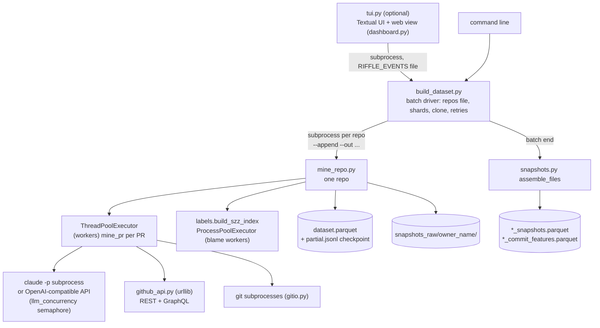
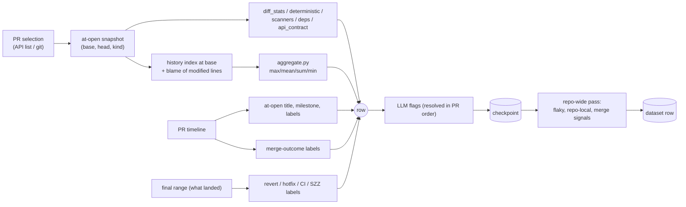

# Riffle repo miner: full reference

Complete description of `pipelines/ingestion/repo_miner/`: what it is, why it is built the way it is, how a run works step by step, every module, every output column, every file it writes, every flag and every tunable.

- Written against **miner version 6.4.0** (`version.py`). Contract versions: `mined_dataset` 1.2, `mined_snapshot` 1.3, `mined_commit_features` 1.0, `mined_features` 1.0.
- Where this document and the code disagree, **the code is right**. The short operator guide is `README.md` in this directory; this file is the long form, and does not replace it.
- Column lists were checked against `contracts/mined_dataset.schema.json`, `mined_snapshot.schema.json` and `mined_commit_features.schema.json` (section 14). The contracts, not this file, are the source of truth for names and types.
- British spelling, as in the ADRs.

## Contents

1. [What the miner is and why it exists](#1-what-the-miner-is-and-why-it-exists)
2. [Design principles and the reason for each](#2-design-principles-and-the-reason-for-each)
3. [Architecture](#3-architecture)
4. [How a run works, step by step](#4-how-a-run-works-step-by-step)
5. [Feature families: how each is computed and why](#5-feature-families-how-each-is-computed-and-why)
6. [Labels (targets)](#6-labels-targets)
7. [The LLM subsystem](#7-the-llm-subsystem)
8. [The GitHub API subsystem](#8-the-github-api-subsystem)
9. [The git subsystem](#9-the-git-subsystem)
10. [SZZ fix tracing](#10-szz-fix-tracing)
11. [PR snapshots](#11-pr-snapshots)
12. [Scaling, resuming and repairing](#12-scaling-resuming-and-repairing)
13. [Observability and operator tools](#13-observability-and-operator-tools)
14. [Schema reference: every column](#14-schema-reference-every-column)
15. [Files the miner reads and writes](#15-files-the-miner-reads-and-writes)
16. [Command-line reference](#16-command-line-reference)
17. [Environment variables](#17-environment-variables)
18. [Tunables (`Settings`)](#18-tunables-settings)
19. [Tests](#19-tests)
20. [Known limitations and sharp edges](#20-known-limitations-and-sharp-edges)
21. [Version history](#21-version-history)
22. [Glossary](#22-glossary)

---

## 1. What the miner is and why it exists

### 1.1 What it is

The repo miner turns a **cloned GitHub repository plus the GitHub API** into a training table: **one row per closed pull request**, with

- every feature the Riffle scorer would have seen **at the moment the PR opened**, and
- the **outcomes** that happened afterwards (did it merge, was it reworked, was it reverted, did CI break, was it hotfixed, why was it closed).

It also produces two derived tables for training on PRs *while they are open* (snapshots and per-head-commit features).

It is a Python package of plain scripts (no installable package). `git` and the standard library are enough for the core; everything else (lizard, semgrep, pandas/pyarrow, an LLM) is an optional stage that degrades to `null` columns.

### 1.2 Where it sits in Riffle

Riffle is a self-hosted GitHub App that ranks pull requests by learned risk. Training data has to come from somewhere. The decision (ADR 0009 note, `pipelines/ingestion/README.md`) is that the miner's own rows are the **primary training data**; other datasets (On the Shoulders of Giants, ApacheJIT) are secondary and AIDev is **not** ingested because the miner produces the same labels from scratch.

```
repos file ──► build_dataset.py ──► mine_repo.py (one process per repo)
                                        │
                                        ├─► dataset.parquet            one row per closed PR
                                        ├─► snapshots_raw/<repo>/      raw capture (clones are deleted)
                                        └─► ci_cache/, health/, logs/  caches, checks, traces
                                  (batch end)
                                        ├─► dataset_snapshots.parquet        one row per PR snapshot
                                        └─► dataset_commit_features.parquet  one row per head commit
                                  (several PCs)  merge_shards.py ──► *_merged.* tables
                                  (training)     pipelines/training/frames.py joins the three tables
```

### 1.3 Two targets from one run (ADR 0002 and ADR 0009)

| Target | Question | Rows it trains on | Known at |
| --- | --- | --- | --- |
| `label_bad` (ADR 0002) | Did a **merged** PR break: revert OR failed required CI OR hotfix? | merged PRs only | 7 to 90 days after merge |
| `label_merged` (ADR 0009) | Will the PR **merge at all**, and if not, why? | every closed PR | at close |

They are **never combined** into one label. Rationale (ADR 0009): a rejected PR is not a broken change, and the two have different maturity. A combined risk, if wanted, is `P(merge) × P(bad | merged)`.

Further derived targets sit on every row (`outcome_3class`, `nowhere_reason`) so every consumer trains on the same definitions (proposal Part 4).

### 1.4 Why a miner at all, and why scratch-mined

- The scorer scores a PR when it opens. A model has to learn from PRs whose *future* is known, so every historical PR must be reconstructed **as it was when it opened** and paired with how it ended.
- Third-party datasets do not carry the GitHub timeline signals (reviews, force-pushes, duplicate marks, close reasons) the merge model needs, nor the point-in-time discipline of ADR 0010. Mining from scratch gives one consistent definition of every feature and label, and lets mining and serving share extractor code later.

---

## 2. Design principles and the reason for each

| Principle | What it means in code | Why |
| --- | --- | --- |
| **Point-in-time, no leakage** | Diff features come from the PR as it stood at `created_at + 300 s` (ADR 0010). History/blame walk only commits before the base commit. Repo-wide aggregates (merge rates, similar PRs, scrutiny) count a past PR only if it **closed before this PR opened**, and an outcome only if it **happened** before then. | The scorer sees only the past. A feature that peeks (final size after rework, today's PR title, labels added after a failure) makes offline scores overstate production. |
| **Features at open, labels from what landed** | `mine_pr` uses two ranges: the *at-open* range for features and the *final* range (what actually merged) for post-merge labels. | Rework after open is part of what the targets measure, so it must not leak into the inputs; revert/hotfix/CI/SZZ are about what landed. |
| **Deterministic first** | Regex, parsers and linters are used wherever an exact answer exists (secrets, off-by-one-ish edits, migrations, manifests). The LLM only answers semantic questions. | Cheap, reproducible, auditable; the LLM is never the verdict and is never on the scoring path. |
| **Missing is `null`, never `0`** | A tool that is absent, a network call that failed, too little history: the column is `null` (XGBoost/LightGBM treat it as missing). `0` means "measured, found none". | A silent `0` is a lie the model will learn. Matches the contract rule `null` = not declared/not enough history. |
| **Never write a row without its LLM answer** | A failed LLM call is retried per PR (3×, waits 60/120/180 s). If it still fails the repo stops (exit code 3) and `--out` is not written. Rows out of LLM *scope* keep null LLM columns on purpose. | Half-populated LLM columns would be a hidden bias (failure correlates with diff content). |
| **Every row has every column** | `mined_dataset.schema.json` lists the columns; a stage that is off writes `null`, not "missing". | One schema for every run mode. `tests/test_dataset_contract.py` enforces it both ways. |
| **Resumable, crash-safe** | Rows stream to `<out>.partial.jsonl`; PR selection is pinned; SZZ blames are stored per (fix commit, file); LLM answers are reused on re-mine. | A big repo takes hours; stops (ctrl+c, quota, crash, reboot) must lose nothing. |
| **Output identical regardless of parallelism** | PRs mine in worker threads but are **consumed in PR order**; the LLM circuit breaker counts consecutive PRs, not whichever worker finished first. | Reproducible datasets and a meaningful "consecutive failures" rule. |
| **Graceful degradation** | lizard/semgrep/oasdiff/buf/graphql-inspector/network each degrade to `null`. A repo with no token still mines (with fewer columns). | Different machines have different toolchains; a missing tool must not abort an overnight run. |
| **Observable** | Run log, structured trace, progress events, health check, TUI, web view. | A run takes hours or days; a stall must be explainable without guessing. |
| **Contract-bound** | Adding a column means adding it to the contract in the same PR. Version bumps: MAJOR = output columns/meaning change (retrain-level), MINOR = new features/flags with unchanged existing output, PATCH = fixes that leave output identical. | Training, serving and the feature store must agree on what a field means. |

---

## 3. Architecture

### 3.1 Process and thread model



- **`build_dataset.py`** runs each repo as a **separate `mine_repo.py` subprocess**. One process per repo bounds memory (a Kubernetes-sized history is large) and means a crash or Stop only affects that repo; the checkpoint makes a retry resume.
- **`mine_repo.py`** mines PRs in a thread pool (work is mostly git subprocesses, so threads are fine). SZZ blame uses a **process pool** because it is CPU/blame heavy.
- **LLM calls** are bounded by a global semaphore (`llm_concurrency`, default 4) across all workers.
- **Global state** (per process = per repo): the git numstat cache, blame LRU cache (64 entries), lizard complexity caches, LLM usage counters, quota gate, the run trace.

### 3.2 Module map (every file)

| File | Role |
| --- | --- |
| `version.py` | `__version__` (semver rules in the docstring). Written to every row as `miner_version`. |
| `config.py` | `.env` auto-loader, `Settings` dataclass (all tunables), path rules (`PATH_RULES`, test/doc/generated patterns), language map, word-boundary fix/revert/hotfix text matchers, `subsystem_of`, RAM-aware default worker count. |
| `gitio.py` | All git access: numstat history cache, blame, diffs, merge-base, commit parents, ref fetching, landed-commit index, first-parent chains. |
| `github_api.py` | REST/GraphQL client (stdlib `urllib`): PR lists, window selection, timelines, review events, force-pushes (GraphQL), check conclusions, required checks, CI history map, user account age. Rate-limit aware. |
| `mine_repo.py` | Per-repo orchestrator and CLI. `mine_pr` (one PR → one row), selection pinning, at-open snapshot resolution, concurrency index, writer. |
| `build_dataset.py` | Batch driver: repos file parsing, domain tags, sharding, clone, retries, skips, audit/re-mine, snapshot assembly, shard manifest. |
| `aggregate.py` | Collapses per-file dicts into fixed `max_/mean_/sum_/min_/median_` columns (`AGG_SPEC`). |
| `labels.py` | Breakage labels (`label_revert`, `label_ci_fail`, `label_hotfix`, `label_szz_bug`, `label_bad`, observability columns) and the SZZ index builder. |
| `merge_labels.py` | Merge-outcome labels (ADR 0009), close-reason rules and LLM classifier prompt, at-open metadata rebuilt from the timeline, `outcome_3class`/`nowhere_reason`. |
| `flaky.py` | Flaky-check detection; corrects `label_ci_fail`/`label_bad` after a repo is mined. |
| `maintainers.py` | "Who is a maintainer" evidence from the repo's own timelines (point-in-time). |
| `scope.py` | Which PRs are "training PRs" (outside non-bot contributors plus a stable 5% sample). |
| `features/diff_stats.py` | Kamei size/diffusion metrics, diff shape, path flags. |
| `features/history.py` | Source 2: per-file and per-author history index at the base commit; hotspots, ownership, co-change, experience, percentiles. |
| `features/line_history.py` | Source 3: blame of the exact lines the PR modifies. |
| `features/scanners.py` | Source 4d: lizard complexity delta, semgrep new findings. |
| `features/deps_cve.py` | Source 4e: dependency changes, OSV vulnerabilities, GHSA cross-check. |
| `features/deterministic.py` | Source 5: regex/parser checks on added lines. |
| `features/api_contract.py` | Source 5: oasdiff / buf / graphql-inspector verdict on spec files. |
| `features/llm_flags.py` | Source 6: 23 LLM flags, backends, diff slimming, quota gate, circuit breaker, usage counters, reuse store. |
| `features/merge_signals.py` | AIDev-catalog merge-model signals: body structure, agent detection, repo-level prior-only rates, text similarity. |
| `features/repo_local.py` | The nine repo-local columns of `mined_features.schema.json`. |
| `snapshot_capture.py` | Capture step of PR snapshots (runs during mining). |
| `snapshots.py` | Assembly step of PR snapshots (offline, from captures). |
| `consistency.py` | Does the snapshot table still match its dataset? |
| `merge_shards.py` | Joins the tables of several PCs, refusing mismatched pieces. |
| `naming.py` | Output/log naming for sharded runs, shard manifest path, snapshot table names. |
| `health.py` | Per-repo health summary and flags. |
| `sync.py` | Sends a PC's logs, health, datasets and shard manifest to the team store (ADR 0015); incremental, bounded, never fatal. |
| `runlog.py` | Structured run trace (`*.trace.jsonl`), stage/step/span timing, heartbeat, stall detection. |
| `trace_report.py` | Summarises a trace file. |
| `progress.py` | Progress events (`RIFFLE_EVENTS`) for the TUI. |
| `tui.py` | Terminal UI (Textual) driving `build_dataset.py`. |
| `dashboard.py` | Read-only LAN web view of the TUI, "big picture" mode. |
| `doctor.py` | Environment checks and fixes (run on every TUI launch). |
| `deps.py` | Installs Python dependencies; manages the private `.venv` on PEP 668 systems. |
| `scout.py` | Metadata-only ranking of candidate repos (no clone). |
| `llm_compare.py` | Compares two LLM models on the same diffs, per flag agreement. |
| `audit_export.py` | Stratified CSV for the human label audit. |
| `repos.txt`, `repos_web_ts.txt`, `repos_vite.txt` | Repository lists (see 15.1). |
| `.env.example`, `requirements.txt` | Config template and optional dependencies. |
| `tests/` | See section 19. |

### 3.3 Data flow of one row



---
## 4. How a run works, step by step

### 4.1 The batch: `build_dataset.py`

`python build_dataset.py` reads a repos file and mines every repo into **one growing dataset**, de-duplicated by `(repo, pr_number)`.

1. **Output naming.** With `--shard K/N` the output is tagged (`dataset.parquet` → `dataset_pc1of3.parquet`, run log `run-<time>-pc1of3.log`). `--out-prefix` / `--out-postfix` add text (placeholders `{pc} {n} {host} {date}`; a postfix replaces the automatic tag); `--no-auto-name` turns the tag off. A name that already carries its tag is left alone, so a rerun resumes the same file. If an untagged file exists but is not used, the run says so, because resume only looks at the tagged file. *Why:* several PCs writing the same `dataset.parquet` get mixed up when copied together.
2. **Trace.** `runlog.configure` points `RIFFLE_TRACE` at `logs/<run-stem>.trace.jsonl` (inherited by every child miner).
3. **Audit-only and shard-plan-only modes** print and exit (see 12).
4. **Read the repos file.** Each line is a GitHub URL; text after `#` is a comment but carries two tags: `[~N commits]` (approximate commit count, used as the repo's weight) and `[domain: NAME]` (ADR 0011). `--only-domain NAME` keeps matching repos only. A GitHub URL is parsed with `github.com[:/]owner/name(.git)`.
5. **Shard.** `balanced_shards` gives each PC an equal number of repos (±1) with balanced total weight: heaviest repo first, each to the lightest PC that still has room; unknown weights count as the median; deterministic, so every PC computes the same split. `split_id` is the first 8 hex of a SHA-256 over the ordered repo list, weights and PC count; PCs that print the same split ID have disjoint shares of the same list.
6. **Test mode** (`--test`): first repo only (default `pallets/flask`), `--test-prs` PRs (10), fresh output `test_output/test_dataset.jsonl` (also saved as parquet to check that path), clone kept. It always mines the fixed window `config.TEST_WINDOW_FROM..TEST_WINDOW_TO` (2020-01-01 to 2025-06-30) with `--min-age-days 0` and no `--cap-on` or `--max-unmerged`, whatever the form or flags say, so every PC and every run picks the same PRs whatever day it runs. `--test-prs` then caps merged and unmerged PRs together (the newest contiguous block, mode A), so the output holds about that many rows. Remaining sources of drift: a PR created in the window that was still open on the first run and closes later, and a stale reused clone (merge-landing detection reads it).
7. **Re-mine.** `--auto-remine` audits the output and adds flagged repos in this PC's share; each `--remine-repo` must be in this PC's share (else the run stops with nothing changed). `_drop_repo` keeps the repo's earlier LLM answers (`ci_cache/<owner>_<name>.llm_reuse.json`, keyed by base and head SHA), rewrites the dataset atomically without the repo, removes its SZZ cache, partial files, blame store and pinned selection, and removes its checkpoint lines.
8. **Skip finished repos** (rows already in `--out`; `--remine` disables). A repo only lands in `--out` after a clean complete mine, so presence means done.
9. **For each repo:**
   - `--skip-big N` skips repos whose `[~N commits]` tag is larger; the TUI can also request a skip through the file named in `RIFFLE_CONTROL`. A skip never writes rows, so a later run mines the repo.
   - **Clone** (full history, never `--depth`) into `<clone-dir>/<owner>_<name>`, retried (`--repo-retries`, default 2 extra) with waits of `min(120, 15 × attempt)` s. An existing clone is removed unless `--skip-existing`.
   - **Mine** by running `mine_repo.py` as a subprocess with `--append` and the pass-through flags. A retry resumes from the checkpoint. **Exit code 3** (LLM could not answer) aborts the whole batch without retry. A Stop or skip sends SIGINT first so the miner keeps its checkpoint, then kills after 30 s.
   - After a **successful** mine the clone is deleted (one clone on disk at a time) unless `--keep-clones`. A failed or stopped repo keeps its clone so a rerun resumes without re-cloning. `ci_cache/`, checkpoints and `snapshots_raw/` are kept.
10. **Batch end:** save test parquet (test mode); **assemble snapshots** (section 11; failure never fails the batch); write the **shard manifest** (`<out>.shard.json`) for sharded runs; emit `batch_done`; print skips and failures.
11. **Stop** (ctrl+c): one `[stop]` line, child miner stopped with its checkpoint kept, exit 130.

### 4.2 One repo: `mine_repo.py`, stage by stage

The run log gets `[stage] X done in 2m57s` for each stage and the trace gets start/done events with durations.

| # | Stage (`runlog` name) | What happens | Why | API cost |
| --- | --- | --- | --- | --- |
| 0 | setup | Find default branch (`origin/HEAD`, else `main`/`master`/`HEAD`). `snapshot` = now. `obs_cutoff` = newest commit time on the default branch in this clone, capped at now. Configure blame (`-w -M`, plus the repo's own `.git-blame-ignore-revs` if present). Build `GitHubAPI` unless `--no-network`. | `obs_cutoff` says how far forward outcomes can be seen **in this clone**; reverts after it are not there. Blame flags and ignore-revs stop formatting sweeps being blamed as the author. | none |
| 1 | `fetching PRs` | Select PRs (4.3): merged, unmerged, stale-open, lead-in, block start. Resume loads the pinned selection instead. | Defines which rows exist. | 1 call per 100 closed PRs, plus lead-in and open-PR pages |
| 2 | `required checks` | Read the default branch's required status checks from branch protection. | Distinguishes gating CI from auxiliary checks precisely. 403/404 is normal for repos you don't own and falls back to a name denylist. | 1 |
| 3 | `merge style` | Decide whether the repo is merge-commit, squash, or rebase style (4.4). | Picks the right diff base for 1-parent merges. | 1 (+1 per multi-commit PR in rebase repos) |
| 4 | `timelines` | Read every PR's issue timeline up front (parallel, up to 8), build maintainer evidence, set `_author_maintainer` on every PR. Pinned selection also pins the evidence. | Merge labels, at-open metadata, lead-in signals and maintainer detection all need timelines; reading once avoids refetching. | 1+ per PR (100 events per page, 2000 cap) |
| 5 | `author index` | `author_email → sorted times of that author's merged PRs`, from one local `git show` per PR. | Point-in-time `author_prs_merged_repo`. | none |
| 6 | `open snapshots` | Fetch heads missing from the clone (`refs/pull/N/head`), ask GraphQL for force-pushes (25 PRs per call), fetch replaced heads by SHA, resolve `pr["_open"]` (4.5). | ADR 0010: features from the PR as it opened. | 1 GraphQL call per 25 PRs |
| 7 | `concurrency` | For each PR count other PRs open at its opening that touch the same files / same base-side lines. | Integration-risk features; point-in-time by construction. | none (git diffs in parallel) |
| 8 | `ci history` | Build `{commit: failure|success}` from the Actions workflow-runs list (100 runs/call, cached to `ci_cache/<owner>_<name>.json`). | Historical CI-fail-rate features (file/author). Far cheaper than one check-runs call per commit. | ≤ 400 calls once, then cached |
| 9 | `loading history` | Parse the whole repo's `git log --all --numstat -M` once (streamed) into an in-memory cache. | Every history feature, SZZ and `path_size_pctile` reuse it; otherwise ~1.5 minutes would be silently spent inside the first PR on a Kubernetes-sized repo. | none |
| 10 | `szz` | Build or reuse the SZZ index (section 10). | `label_szz_bug`, `days_to_szz_fix`. | none |
| 11 | `mining PRs` | Mine PRs in worker threads, consume in order, resolve LLM answers, write checkpoint and capture records. | The main work. | per PR, see 4.6 |
| 12 | `repo-wide labels` | `flaky.apply`, `repo_local.compute_repo`, `merge_signals.compute_repo` (4.7). | These need every PR's outcome. | none |

Afterwards `main()` writes the dataset (`_write`), runs the health check, deletes the one-shot LLM reuse file, prints LLM usage, and **only after a clean complete write** removes the checkpoint and the pinned selection.

### 4.3 Choosing which PRs become rows

There are four selection modes (plus `--full-repo`, below). Drafts are always left out (never offered for review).

**A. Date-window mode** (`--window-from/--window-to`, set both; the recommended mode for dataset runs). `GitHubAPI.window_prs`:

- Pages through **closed** PRs sorted by creation, newest first, 100 per page.
- Keeps every closed PR **created** in the window, merged and unmerged together, so every repo covers the same span and keeps its **real merged/unmerged mix**.
- A PR is dropped if its outcome (merge or close time) is younger than `--min-age-days` (default 90), so labels are mature (30-day revert window, 90-day SZZ window).
- `--max-prs N` keeps the **newest contiguous block** of that many PRs by creation time. With `--cap-on training` only *training PRs* count toward N (outside non-bot contributors plus the 5% sample, `scope.py`), so `--max-prs 10000 --cap-on training` yields about 10,000 PRs to train on. Maintainer and bot PRs inside the block are still mined (history needs them) but do not count. Maintainers confirmed from history are known only after timelines are read, so the training count can come out slightly below the cap.
- **History lead-in:** closed PRs created in the `--lead-in-days` (default 180) before the block are collected as **metadata only** (the PR list plus one timeline call each). They are never mined into rows; they give the block's first PRs their merge-signal history (`repo_outside_merge_rate`, first-response times, agent load, similar PRs). Breakage history (`similar_pr_*`, `path_failure_mode_*`) needs mined outcomes, so it still starts empty.
- The line `[window] ...` reports merged, unmerged, training PRs, block start and lead-in.

**`--full-repo`.** Mode A with the window fixed to `config.FULL_REPO_FROM..FULL_REPO_TO` (2000-01-01 to 9999-12-31), `max_prs` unset and `lead_in_days` 0: every closed, non-draft PR the repo has, merged and unmerged, minus those younger than `--min-age-days`. The dates are fixed, not today's, so a resumed run's pinned selection still matches. Rejects `--window-from/--window-to`, `--max-prs`, `--lead-in-days`, `--cap-on` (and `--test` in `build_dataset.py`).

**B. Legacy mode** (no window). `merged_prs`: fetches closed PRs by creation order, collects merged ones, sorts by `merged_at`, keeps the newest `--max-prs`. Unmerged PRs are taken from the same span as the merged ones: closed between the oldest and the newest kept merge (from 6.11.0; before that only the lower creation bound applied, so a cap on merged PRs left the unmerged ones unbounded and skewed the merged share). Open PRs with no response are bounded by the newest kept merge as well. A small over-fetch covers created-vs-merged reordering at the boundary.

**C. Landed-commit mode.** Some repos never use GitHub's merge button (merge scripts, bots), so their PRs are only "closed". On the first page, if under half of closed PRs merged through GitHub **and** at least half of the closed-unmerged PRs link to a commit on the default branch, the miner switches to landed-commit mode: `gitio.landed_commit_index` maps PR numbers to commits on the default branch (recognised links: `Pull Request resolved: <url>` (PyTorch), `PR-URL: <url>` (Node.js), `Closes/Resolves #N`, subject ending `(#N)`, `Merge pull request #N`). Such rows have `merge_via = landed_commit`. In this mode **closed-unmerged PRs get no rows** because "not merged" is ambiguous. *Why both conditions:* a low GitHub-merge share alone also describes a repo flooded with rejected AI PRs. `Settings.merge_signal` (`auto|github|landed`) forces a mode but has no CLI flag.

**D. Git-primary discovery** (`--pr-discovery git`). Enumerate merged PRs from the default branch's commit messages (same link patterns); the API only *enriches* each PR (`fetch_pr`: created_at, base ref, head, labels, association, draft, milestone, authoritative merged_at). No closed-PR pagination; works offline for discovery. PRs without a recognisable reference are missed; no unmerged rows. Used by the offline contract test.

**Unmerged rows.** The unmerged PRs' commits are fetched from `refs/pull/N/head` **without creating local refs**, so `git log --all` scans (history cache, revert/hotfix search) never see unmerged work as history or as revert candidates. The diff base is the merge-base of the base commit GitHub recorded (or the default branch when it is gone) and the head. PRs whose head cannot be fetched are dropped.

**Stale-open rows.** PRs still open after `abandon_days` (60) with no human non-author comment or review are rows too: unmerged, abandoned, `closed_at` null, `close_reason = abandoned`, `close_reason_source = rules`. Open PRs that did get a response have no outcome yet and are left out. Only open PRs created in the mined block's creation window are considered; not in landed-commit mode.

**Pinned selection (v5.1.0).** The first run of a repo writes `ci_cache/<owner>_<name>.selection.json`: the merged, unmerged, stale-open and lead-in PRs, lead-in sidecars, block start, landed flag, incomplete flag, and the maintainer evidence, plus the selection parameters (`window_from/to`, `max_prs`, `min_age_days`, `lead_in_days`, `merge_outcome`, `max_unmerged`, `merge_signal`, `abandon_days`, major version). A resume with the **same parameters** mines exactly the same PRs even if more PRs merged since, and skips the PR list, lead-in and timeline fetches. A run with different parameters makes a new selection. Removed after a clean write and by `--remine-repo`. *Why:* new merges would otherwise shift the selection, orphan the checkpoint's rows and change the SZZ relevant set.

**Truncation.** If a PR-list page fails the list is marked `incomplete` and a warning says label coverage is partial.

### 4.4 The diff range, merge styles and the at-open snapshot

There are two ranges per PR (ADR 0010).

**Final range** (`_pr_diff_range`): what **landed**, immune to a stale API `base.sha` (which would pull in unrelated commits that landed on main between open and merge).

| Merge shape | Base | Head |
| --- | --- | --- |
| 2-parent merge commit | merge-base(p1, p2) | p2 (equivalently `git diff p1...p2`) |
| 1-parent squash / normal | merge commit's parent | merge commit |
| 1-parent **rebase** merge | `head~N` (N = PR commit count) | merge commit |
| landed-commit (git base known) | parent of the oldest linked commit | newest linked commit |
| root commit (no parents) | API `base.sha` | merge |
| closed-unmerged | merge-base(base, head) | PR head |

**Merge style detection** (`_make_base_resolver`, once per repo): one call to repo settings for allowed merge methods plus a local parent-count sniff over up to 50 PRs. If at least half are 2-parent merges the repo is merge-dominant. Per-PR commit-count calls are paid **only** when the repo is plausibly rebase-style (not merge-dominant, rebase allowed, API on). In repos allowing both squash and rebase, a cheap local author-overlap check (`_looks_rebased`: a majority of `head~1..head~(n-1)` share the PR author) confirms each multi-commit PR. Squash and merge-commit repos cost nothing extra. The printed `[merge-style]` line states the verdict.

**At-open snapshot** (`_open_snapshot`): the PR as it stood when it opened.

- **Head:** the newest commit on the PR branch's **first-parent line** committed at or before `created_at + rework_grace_s` (300 s, the same grace `label_rework` uses). The walk stops at GitHub's recorded `base.sha`, so commits landed on the base branch with their original dates cannot be mistaken for the PR's.
- **Force-push after open:** GraphQL `HeadRefForcePushedEvent.beforeCommit` is the head the push replaced (the REST timeline does not keep it). The walk starts from the `beforeCommit` of the first force-push after the grace period, fetched by SHA (GitHub still serves it).
- **Base:** merge-base of that head and `base.sha`. History features use this base, never after open. `base_behind_by` = base-branch commits the fork point was behind at open.
- **`open_snapshot`** says how it was found:
  - `exact`: no force-push after open (known from GraphQL),
  - `recovered`: walked from a replaced head,
  - `approx`: force-push history unreadable (no token, failed batch),
  - `final`: not recoverable; diff features use the final range and **may leak**. Training drops or masks diff features on `final` rows (`frames.py` nulls the diff features). A PR whose at-open diff turns out empty is downgraded to `final`.
- Commit times are *commit* dates (push time is not exposed by the APIs): a commit made before open but pushed after it counts as part of the PR at open.

### 4.5 `mine_pr`: one PR becomes one row

Run inside a worker thread; every step is timed (`runlog.step`). Returns `None` (a "no-rows" skip) when there is no diff, a missing commit or a shallow clone.

1. **Ranges.** Final range, then at-open range (`pr["_open"]`) else final with `open_snapshot = final`. If the at-open diff is empty, fall back to final.
2. **Identity.** `author_email` is the **mailmap-canonical** git author (`%aE`) of the commit that is the PR's own head (`_feat_head`: p2 of a 2-parent merge, the merge commit for a squash, the PR head for unmerged), *not* the maintainer who merged. This makes EXP, REXP and every author feature about one person.
3. **Timeline** (`pr["_events"]`, or fetched if missing). Used for merge labels and to rebuild the title, milestone and labels **as at open + grace** (`merge_labels.at_open`). *Why:* maintainers retitle rejected PRs ("AI spam") and milestone accepted ones; in one pilot repo 210 of 312 titles had changed.
4. **`diff_stats`** (Source 4a/4b) → size, spread, path flags.
5. **History index** at the base commit (`history.build_repo_index`, restricted to the changed paths), then per file `per_file_features` + `line_history.per_file_line_features`.
6. **`LT`, `la_norm`, `ld_norm`, `AGE`**; `aggregate.aggregate_per_file` → `max_/mean_/...` columns; `cochange_features`; `test_expectation_features`; `author_features`; `repo_revert_base_rate`; `FIX`; `author_prs_merged_repo`; bot/agent flags; `EXP/REXP/SEXP`; percentile features; `base_behind_by`; concurrency; hotspot membership.
7. **`deterministic`**, **`scanners`**, **`deps_cve`**, **`api_contract`** on the at-open diff.
8. **Repo-local:** `path_size_pctile` now; the sidecar for the repo-wide pass; review events (2 API calls per PR, unless `--no-review-history`).
9. **LLM fetch** (`llm_flags.fetch`) in the worker; resolved later in PR order.
10. **PR metadata** (`_pr_metadata`, with title/milestone from the at-open rebuild), **merge signals** (body features, agent name, branch prefix, account age, repo files at base), `declared_hotfix`.
11. **Breakage labels** (`labels.build_labels`) on the **final** range, or all post-merge columns `null` for unmerged PRs (`observed_through` null, `mined_at` set).
12. **Merge-outcome labels** (`merge_labels.build_merge_labels`), with one check-runs call on the head commit for non-stale unmerged PRs and a classifier call when applicable; or the 13 columns set to `null` with `--no-merge-outcome`.
13. **Provenance** columns (`miner_version`, `miner_commit`, `llm_model`, `llm_prompt_version`, `domain`).
14. **Snapshot capture** for rows in LLM scope (section 11).

Private keys carried on the row until written: `__llm__` (the fetch result), `__capture__`, `_repo_local`, `__merge_signals__`, `__ci__`. They are popped before the dataset is written (the checkpoint keeps the sidecars so a resumed run can still do the repo-wide pass).

**Failure handling per PR:** a `GitError` is a `git-error` skip; any other exception is an `exc:<Type>` skip with a warning; `LLMUnavailable` stops the repo. Skips are counted and printed (`[skips] N/M PRs produced no row`).

### 4.6 The ordered consumer: parallel yet reproducible

- `--workers N` (default `min(6, CPUs)` lowered to fit free RAM: `(free RAM − 1.5 GB) // 0.8 GB`; `RIFFLE_WORKERS` overrides; the miner says when it lowered it). One October 2026 run peaked at 5.5 GB with 6 workers on a large repo.
- A window of `max(2 × workers, 2 × llm_concurrency)` futures is kept in flight; results are consumed **in PR order**.
- For each result the consumer (main thread): prints `[pr i/N] #num (Xs)`, handles skips, pops `__llm__`, **retries a failed LLM answer in place** (`_retry_llm`; later PRs queue behind it so the miner pauses), resolves the flags (`llm_flags.resolve` drives the consecutive-failure breaker), then commits: capture record and index entry written, row appended, checkpoint line written and flushed.
- Interrupts: ctrl+c shuts the pool down without waiting; finished PRs are in the checkpoint; SZZ blame workers ignore SIGINT so there are no per-worker tracebacks.

### 4.7 The repo-wide pass

Needs every PR's outcome, so it runs once all rows exist (and is skipped if the LLM breaker tripped):

1. **`flaky.apply`** corrects `label_ci_fail`, `ci_fail_flaky_only` and `label_bad` (6.4).
2. **`repo_local.compute_repo`** fills the PR-history columns (`similar_pr_*`, `path_failure_mode_*`, `path_detection_lag_days`, `revealed_path_scrutiny`, `release_cycle_position`).
3. **`merge_signals.compute_repo`** fills the eight prior-only repo-level columns using the lead-in sidecars too.
4. Sidecars are stripped; any missing merge-signal or repo-local column is set to `null` (`similar_pr_count` defaults to `0`).

### 4.8 Writing and de-duplication

- `--out` may be `.parquet` (default; falls back to `.jsonl` with a warning when pandas/pyarrow are missing, *before* the append merge so every repo appends to the same file), `.jsonl` or `.csv`.
- `--append` merges into an existing file and de-duplicates by `(repo, pr_number)` keeping the **newest** extraction. If the existing file cannot be read, the run writes `<out>.recover-<time>.jsonl` and **leaves `--out` unchanged** (never clobbers the accumulated dataset).
- Row order: merged PRs newest-merged first, then unmerged PRs.

### 4.9 After mining

- **Snapshot assembly** (section 11) runs at batch end.
- **Shard manifest** (`dataset_pc1of3.shard.json`): split ID, PC, N, miner version, host, finish time, repos, mined-OK count, failures, file names.
- **Admin** (`admin.py`, ADR 0015): the lead's `list`, `revoke NAME`, `revoke-split ID` and `whoami` over the store's `/v1/admin/*` endpoints, with `RIFFLE_ADMIN_TOKEN` from `.env`.
- **Joining a split** (`join.py`, ADR 0015): `--shard-plan N --issue-tokens` asks the store (admin token) for one write token per PC, bound to the plan's split ID and optionally expiring (`--token-days`), and prints a join code per PC (`riffle1.` plus base64 JSON: store URL, token, split, PC K of N, miner version, and the plan's flags without the plan-only ones). `join.py CODE` calls the store's `/v1/whoami`, writes `RIFFLE_SYNC_URL` and `RIFFLE_SYNC_TOKEN` to `.env` and prints `build_dataset.py <flags> --shard K/N`. At the start of a run `_sync_begin` re-checks the token and turns sync off, with the reason, when it is rejected or its split is not the split these flags compute. `doctor.py` has a Team store line.
- **Central sync** (`sync.py`, ADR 0015), when `RIFFLE_SYNC_URL` and `RIFFLE_SYNC_TOKEN` are set: after each repo, on a Stop and at batch end, `build_dataset.py` PUTs the run log and trace, `health/*.json`, the dataset, its snapshot and commit-feature tables, the `.partial.jsonl` checkpoint and the shard manifest under `<miner_version>/<split_id>/`, then a `run.json` with the counts and reason. `run.json` carries each repo's state (pending, mining, done, failed, skipped), its rows and, once selected, its PR count, so the store can show done and remaining per PC; remaining covers started repos only, since an unstarted repo has no selection yet. While a repo mines, a status-only `run.json` goes out at once when the run starts and when each repo starts, and then every 3 minutes while a repo mines, so the store shows a PC within seconds of Start and its progress within a few minutes. Unchanged files (size and mtime in `.sync_state.json`) are skipped, each PUT carries a SHA-256, and a failure or an unreachable store is a warning that ends that sync, never the run. `ci_cache/`, `snapshots_raw/` and clones stay local. `--no-sync` turns it off.
- **`merge_shards.py`** joins PCs (section 12).
- **Training** reads the three tables with `pipelines/training/frames.py`: joins at load time, splits by PR or repo from a stable hash, nulls diff features on `open_snapshot == final`, drops `near_decided` snapshots, rescales snapshot weights per PR to 1, never offers outcome/id/metadata columns as inputs, and refuses snapshots that no longer match their dataset.

---

## 5. Feature families: how each is computed and why

All "per file" values are for the PR's changed files. The base commit is the at-open fork point. "Before base" means commits with committer time before the base commit's time (git `--before`).

### 5.1 Source 4a/4b: diff size, spread and paths (`features/diff_stats.py`)

Computed from `git diff --numstat -M base...head`.

- Generated/vendored files are removed from the risk counts but their share is kept (`frac_generated_lines`).
- **`LA` / `LD`**: lines added / deleted in non-generated files. **`NF`**: non-generated files. **`ND`**: distinct directories. **`NS`**: distinct subsystems (`config.subsystem_of`: the top directory, or the first **two** components when the top is a generic container such as `src`, `lib`, `pkg`, `packages`, `apps`, `internal`, `cmd`, `crates`, ... so NS and SEXP do not collapse to 1). These are the Kamei (JIT defect prediction) size/diffusion metrics.
- **`Entropy`**: normalised change entropy over per-file (added + deleted) lines, `-Σ p·log2 p / log2(files)`, 0 for a single file.
- **`frac_test_lines`**, **`lang_mix`** (distinct recognised languages), **`n_files_added/removed/renamed`** (`git diff --name-status -M`), **`patch_missing_files`** (files git printed `-\t-` for: binary or too large; `0\t0` rows such as pure renames are not counted).
- **Path flags** (`touches_*`) are `any()` over non-generated changed files using `config.PATH_RULES` (migrations, lockfiles, dependency manifests, CI config, infra, auth-like paths with token boundaries so `author` doesn't match, CODEOWNERS/riffle.yml). **`test_only` / `docs_only`**: all changed files are tests / docs.

*Why:* path flags carry "this kind of change is usually riskier" priors the model should not have to learn from text.

### 5.2 Source 2: repository history at the base (`features/history.py`)

`build_repo_index` makes **one pass over all commits before the base** (from the cached `git log --all --numstat -M`), keeping per-file aggregates only for the PR's changed paths (a vendor bump touching 5k files would otherwise create 25M co-change pairs) but computing repo-wide author aggregates and the repo-wide hotspot ranking.

Per-file (collapsed by `aggregate.py`, see the table in 5.2.1):

- `file_revert_density`, `file_fix_density`: share of the file's prior commits whose subject is a revert / a fix (word-boundary matching, section 5.10). `revert_decay_density`, `fix_decay_density`: sums of `0.5^(age_days / 90)` over such commits (half-life 90 days), so recent ones dominate. `days_since_last_revert/fix`.
- `file_churn_90d`, `file_churn_365d`, `recent_merge_burst_7d`: prior commits touching the file in the window.
- `hotfix_count_365d`: hotfix-worded commits touching the file in the last year.
- `test_cochange_ratio`: share of the file's prior commits where a test file changed too (for non-test files).
- `file_post_merge_ci_fail_rate`: share of the file's commits with a CI verdict whose CI failed (from the CI history map; `null` when no verdicts).
- `file_age_days`: days since the file's first commit before base. `NUC` = number of prior commits touching it; `NDEV` = distinct prior authors.
- `file_complexity_ccn`: **max** function cyclomatic complexity of the file at base (lizard; `0.0` for a file with no functions; `null` for an unsupported language or lizard missing).
- **Ownership by lines** (not commits): the file is blamed at base and each surviving line's author counted. `file_top_author_share` (largest author's share), `file_minor_contributor_count` (authors owning under 5% of lines), `abandoned_lines_share` (share of lines whose author has been inactive more than 180 days as of base). Blame is cached and shared with Source 3.
- **Hotspot** = `churn_365d × max CCN`, ranked across **every** file in the repo at base with recent churn and a lizard-supported language (not just the changed ones), so "touches a top-20 hotspot" is a real repo-relative signal. `file_hotspot_score`, `file_hotspot_rank` (1 = hottest; `null` if unranked), `touches_topk_hotspot`, `n_topk_hotspots_touched`, `min_hotspot_rank_touched`. Only files with recent churn can score, which keeps this cheap on large repos. Complexity is cached per blob and per content hash.
- `_loc` (file lines at base) feeds `LT`; `_last_change_days` feeds `AGE`. Both are internal and not emitted per file.

PR-level:

- **`LT`** = total lines of the changed files at base; **`la_norm` / `ld_norm`** = `LA/LT`, `LD/LT` (0.0 when `LT` is 0). **`AGE`** = mean days since last change across changed files that have history (`null` when none).
- **`cochange_degree`** = max over changed files of the number of "strong partners" (files that changed together in at least 3 prior commits); **`cochange_partners_missing`** = max over changed files of strong partners **not** in this PR ("you usually change X with Y").
- **`expected_test_cochange_missing`**: the PR changes a source file whose `test_cochange_ratio ≥ 0.5` but contains no test file.
- **Author behaviour** (author keyed by canonical email): `author_revert_rate` is smoothed toward the repo base rate, `(reverts + α·base_rate)/(total + α)` with α = 5 (empirical Bayes), where reverts are the author's commits that are reverts; `author_file_familiarity` = share of touched paths the author touched before; `author_days_since_last_change`; `author_post_merge_ci_fail_rate` (same smoothing, `null` with no CI history for the author); `repo_revert_base_rate` = reverts / all commits before base.
- **Kamei experience:** `EXP` = author's prior commits; `REXP` = recency-weighted, `Σ 1/(age_years + 1)`; `SEXP` = author's prior commits in the touched subsystems.
- **Repo-relative percentiles:** `pr_size_pctile_repo`, `nf_pctile_repo`, `entropy_pctile_repo` = fraction of prior non-empty commits strictly smaller. The population is per *commit* (a point-in-time proxy for PR size).
- **`FIX`**: the PR title **at open** plus its head commit subject name a bug/fix as a whole word.
- **`author_prs_merged_repo`**: how many PRs the same git author had merged **before this PR opened** (`bisect` over the author's sorted merged times). `null` without a PR list; `0` for an author with none.
- **`concurrent_open_prs_same_files` / `_same_hunks`**: other PRs that opened at or before this one and were still open at this one's opening, touching a common file / overlapping base-side lines (`git diff -U0`). Computed over the fetched PR set, so a small `--max-prs` undercounts. Unmerged PRs count (closer to what was actually open); stale-open PRs count as open "forever".

#### 5.2.1 Aggregation (`aggregate.py`)

A PR touches 1..N files but the model needs fixed columns. Each per-file feature is collapsed by `AGG_SPEC`; default `max` if unspecified:

| Per-file feature | Emitted columns |
| --- | --- |
| `file_revert_density` | `max_`, `mean_` |
| `revert_decay_density` | `max_` |
| `days_since_last_revert` | `min_` |
| `file_fix_density` | `max_`, `mean_` |
| `fix_decay_density` | `max_` |
| `days_since_last_fix` | `min_` |
| `file_churn_90d`, `file_churn_365d`, `recent_merge_burst_7d` | `max_` |
| `hotfix_count_365d` | `max_`, `sum_` |
| `test_cochange_ratio`, `file_post_merge_ci_fail_rate` | `max_` |
| `file_age_days` | `mean_` |
| `NUC`, `NDEV` | `max_` |
| `file_complexity_ccn` | `max_`, `sum_` |
| `file_hotspot_score` | `max_` |
| `file_hotspot_rank` | `min_` (the hottest file touched) |
| `file_top_author_share`, `file_minor_contributor_count`, `abandoned_lines_share` | `max_` |
| `mod_line_age_days_min` | `min_` |
| `mod_line_age_days_median` | `median_` |
| `mod_lines_distinct_authors`, `mod_lines_prior_fix_share` | `max_` |
| `mod_lines_self_authored_share` | `mean_` |
| `hunk_fix_proximity` | `max_`, `mean_` |

Nulls are ignored in aggregation; if all are null the aggregate is `null`. This is why a column name such as `median_mod_line_age_days_median` looks odd: it is `median_` of the per-file `mod_line_age_days_median`. Note `min_hotspot_rank_touched` (from `_hotspot_touch`) and `min_file_hotspot_rank` (from aggregation) are two columns for the same idea.

### 5.3 Source 3: line-level blame (`features/line_history.py`)

For each changed file, the lines the PR **deletes or modifies** (base-side line numbers from a `-U0` diff) are looked up in the base-commit blame:

- `mod_line_age_days_min` / `_median`: age of those lines.
- `mod_lines_distinct_authors`: how many people wrote them. `mod_lines_self_authored_share`: share written by the PR author.
- `mod_lines_prior_fix_share`: share whose last-touching commit's subject is a fix.
- `hunk_fix_proximity`: recency-decayed (half-life 90 days) count of base lines owned by fix commits that lie within ±5 lines (`hunk_proximity_k`) of any modified line: "you are editing next to old bug fixes".
- Files with no modified lines or no blame (a PR that only adds files) get `null` ages, `0` counts/shares.

These are the only history features anchored to specific lines. They are novel as model inputs: validate with an ablation before claiming lift.

### 5.4 Source 4d: scanners (`features/scanners.py`)

- **lizard** (`ccn_delta`, `max_ccn_changed_func`, `n_funcs_modified`): every changed file in a supported language is analysed at base and head; functions are matched by `long_name`; a function whose CCN changed (a new function compares against 0) counts as modified; `ccn_delta` is the sum of differences, `max_ccn_changed_func` the largest head CCN among them. Removed functions are not counted. `null` when scanners are off or lizard is missing.
- **semgrep** (`semgrep_findings_new`, `semgrep_high_conf_security_new`, `semgrep_cwe_top25_new`): the changed files are exported at head and base to temp dirs and scanned with `--config auto`. A finding is **new** if its `(check_id, path relative to the exported tree, first 80 chars of the matched lines)` is not in the base scan. The base scan is skipped when head has no findings (80% of PRs in the vite pilot; halves semgrep starts). "High-confidence security" = metadata `category: security` and `confidence: HIGH`. The Top-25 flag is true if any new finding's CWE is in a fixed Top-25 set. A semgrep start costs about 4 s, the PR's biggest cost; batching several PRs per process was tried and measured no faster. `null` when disabled; `[]` (zero findings) if semgrep is not installed.

### 5.5 Source 4e: dependencies and CVEs (`features/deps_cve.py`)

Only when a manifest or lockfile changes.

- Ecosystem is inferred from the filename (npm, PyPI, Go, crates.io, RubyGems, Maven, Packagist, NuGet by extension, Pub, Hex). Both versions are parsed best-effort per ecosystem (`pom.xml` resolves `${property}` versions; inherited or unresolved versions are skipped), and each dependency is classified **added / removed / upgraded / downgraded** by semver comparison.
- `n_deps_added`, `n_deps_upgraded`, `n_deps_downgraded`, `n_major_bumps` (upgrades whose major changed) need no network and are always computed.
- With the network: OSV.dev is queried for every before/after `(ecosystem, name, version)`. `osv_vulns_introduced` = IDs present at head and not at base; `osv_vulns_fixed` the reverse. `vuln_has_fix_available` = any introduced record lists a fixed version. `ghsa_max_severity_introduced` (LOW/MODERATE/HIGH/CRITICAL, from GHSA-sourced OSV records, or a CVSS score fallback) and `ghsa_malware_dep` (a `MAL-` ID or alias, or `type: malware`) come from the introduced records.
- `osv_ghsa_disagreement`: for versions newly present at head, does GHSA's GraphQL verdict (vulnerable range match) differ from OSV's? `null` with no token or no usable GHSA answer.
- **Unobserved is not clean:** if any OSV query fails after retries (429/5xx back-off up to 4 attempts, `Retry-After` honoured), **all CVE fields stay `null`** rather than presenting an undercount as a reassuring number. The counts stay set.
- **Caveat:** with no manifest change, the CVE fields are also `null` (the counts are `0`), so for the CVE columns `null` means both "no dependency change" and "unobserved".

### 5.6 Source 5: deterministic checks (`features/deterministic.py`)

Regex over the **added lines** of the diff (and removed lines for observability). Secrets, unused imports and comparison edits are scored on **real source only** (tests, docs and generated files excluded), so a test fixture does not inflate `hardcoded_secret_added`. Env keys are scored on all files because config files legitimately carry them.

| Column | Rule |
| --- | --- |
| `hardcoded_secret_added` | count of added source lines matching: `api_key/secret/password/passwd/token` assigned a quoted string of 8+ chars; AWS key id `AKIA...`; GitHub tokens `gh[pousr]_...`; PEM private key header |
| `new_env_or_config_key` | added lines using `os.environ`, `process.env.`, `getenv(`, `System.getenv(` |
| `observability_delta` | removed log/metric lines **minus** added ones (positive = net removal) |
| `bound_or_comparison_edit` | added source lines containing a comparison, `==`, `!=`, `+1`, `-1` or `[i±1]`: the cheap "off-by-one-ish edit" signal |
| `unused_import_or_dead_code_added` | added `import`/`from` lines whose first symbol never appears in the other added lines (very rough, Python/JS) |
| `dependency_major_bump_count` | packages whose **major** version rose between removed and added manifest/lockfile lines (coarse name/version parse) |
| `migration_reversibility` | `destructive` if an added line in a migration path has `DROP TABLE/COLUMN`, `TRUNCATE`, `DELETE FROM`; `reversible` if a migration changed with none; `null` otherwise |

Note `dependency_major_bump_count` (regex) and `n_major_bumps` (parsed manifests, Source 4e) are two different measurements.

### 5.7 Source 5: API contract change (`features/api_contract.py`)

For changed spec files (`.proto`, `.graphql/.gql`, and `.yaml/.yml/.json` whose first 2,000 characters contain `openapi:` or `swagger:`): OpenAPI → `oasdiff breaking`, protobuf → `buf breaking`, GraphQL → `graphql-inspector diff`. A removed spec is `breaking`, a brand-new one `additive`. `graphql-inspector` exit 0 is `additive`; exit 1 is `breaking` only when it prints `Detected N breaking changes`, otherwise (unparsable schema, crash) the verdict is null. The PR value is the **worst** across spec files: `null` (no spec changed, or no tool installed / the tool failed to give a verdict), `additive`, `breaking`. Each tool is optional.

### 5.8 Source 6: LLM flags

See section 7.

### 5.9 Merge-model signals (`features/merge_signals.py`)

The AIDev feature catalog's merge-model features the miner's own data can supply.

Per PR:

- `has_linked_issue` (`fixes/closes/resolves #N`, `owner/repo#N`, or an issue URL in the body), `body_headings` (Markdown headings), `body_checklist_items` (`- [ ]` / `- [x]`), `body_has_test_plan` ("Test plan", "How to test", "Testing" heading), `agent_boilerplate` (an agent watermark: "Generated with Claude Code", "Co-authored-by: Claude/Copilot", "This PR was generated by", "Devin run", "OpenAI Codex", "Cursor agent", ...).
- `agent_name`: the first matching agent among `claude_code`, `codex`, `copilot`, `cursor`, `devin`, `jules`, `sweep`, tested against the author login, head branch, git email and body. `head_branch_agent_prefix`: branch starts `claude|codex|copilot|cursor|devin|jules|sweep` followed by `/` or `-`.
- `author_account_age_days`: open time minus the account's creation time (one cached `/users` call per author; static so it is point-in-time safe).
- `has_contributing`, `has_agents_md`: files at the base commit (two `ls-tree` calls): a contributing guide at the root, `.github/` or `docs/`; an agent instructions file (`AGENTS.md`, `CLAUDE.md`, `.cursorrules`, `.cursor`, `.github/copilot-instructions.md`).
- The body is read at **mining time** (edits are not in the timeline), so body features can see edits made after open (ADR 0010 open item: body at open from GraphQL `userContentEdits`).

Per repo, **prior-only** (a PR counts only if it closed strictly before this one opened, within the last 365 days; `merge_signal_min_prs = 5`; null below that). Implemented by `merge_signals.History`, indexed so it can be recomputed **as of any moment** (also used for snapshots):

- `repo_outside_merge_rate` (+ `repo_outside_closed_count`): share of outsiders' closed PRs that merged.
- `agent_recent_merge_rate` (+ `agent_recent_closed_count`): same, for the same agent (agent rows only).
- `repo_median_first_response_hours`: median hours from open to the first human non-author comment/review over prior PRs that got one (only responses before the moment count).
- `repo_agent_pr_load_30d`: agent PRs opened in the previous 30 days.
- `max_sim_open_prs`: highest Jaccard word-set similarity (title at open + body, stop-words removed) to a PR open at that moment. `max_sim_recent_merged`: against PRs merged in the previous 90 days.
- The merge rates need unmerged rows, so they stay `null` with `--no-merge-outcome`.
- "Outsider" = `author_association` not OWNER/MEMBER/COLLABORATOR **and** not a maintainer confirmed from history.

### 5.10 Text matchers (`config.py`)

Substring matching ("fix" in the subject) wrongly fires on *prefix, suffix, fixture, debug, dispatch, patch release*. These use whole-token matches with common inflections; underscores and digits count as boundaries (`bugfix_test` matches, `debugger` does not).

- **Fix:** `bug(s|fix(es|ed))`, `fix(es|ed|ing)`, `defect(s)`, `patch(es|ed|ing)`, `hotfix(es|ed)`.
- **Revert:** a subject starting `revert`, `revert "`, `revert:`; a conventional-commit prefix then revert (`fix: revert "x"`, `revert(server): x`, as squash-merge repos title reverts); or "this reverts commit".
- **Hotfix:** `hotfix`/`hot-fix`/`hot fix`, `rollback`/`rolled back`/`roll back`, `quickfix`/`quick fix`, or `urgent|emergency|critical` followed by `fix|patch|bug|issue|regression|security`. **Cherry-picks and backports are deliberately not hotfixes** (they port a change to another branch).

### 5.11 Repo-local mined features (`features/repo_local.py`)

The nine columns of `contracts/mined_features.schema.json`, capturing how **this** repository behaves around the paths a PR touches. Point-in-time rule (contract): a past PR contributes only if it merged before this PR opened **and** its labels were mature (`merged ≤ opened − maturity_days (30)`); its outcome is what was observable at open (an outcome event after open does not count); only reviews submitted before open count. History is **only merged PRs mined in the same run**, so with a small `--max-prs` the oldest rows have little history and come back `null`. Unmerged rows get these columns from the history but never count as past PRs. Thresholds mirror `rules.mining` defaults.

| Column | Definition |
| --- | --- |
| `similar_pr_count` | past mature PRs (within 365 days) with file-set Jaccard overlap ≥ 0.2, capped at the 5 nearest (ties broken by recency); `0`, not null, when none |
| `similar_pr_bad_rate` | with at least 3 neighbours: `(bad + (k − n)·repo_revert_base_rate)/k`, k = 5, missing neighbours filled with the repo base rate; `null` otherwise |
| `path_failure_mode_revert/_ci/_hotfix` | with at least 2 bad past changes on these paths in the last 365 days: share of each primary failure mode (the earliest outcome event) |
| `path_detection_lag_days` | median days from merge to that outcome event over those bad changes |
| `revealed_path_scrutiny` | mean per-file review "scrutiny" on the touched files divided by the repo mean (score = comments + 2 × changes-requested + review rounds, bots excluded, 180-day lookback, at least 5 prior PRs per file and for the window); needs review events (2 API calls/PR) |
| `path_size_pctile` | percentile of this PR's `LA+LD` among prior commits (365 days, before base) touching the same files, weighted by this PR's lines per file, ties count half; `null` with fewer than 10 distinct prior commits |
| `release_cycle_position` | days since the previous release tag divided by the median gap between releases; tags matching `^v?\d+\.\d+(\.\d+)?$`; `null` with fewer than 3 prior releases |

The contract's `evidence` block (similar PRs, top scrutiny path, top failure mode, size context) is for the narrator at scoring time and is **not written** to the training dataset.

### 5.12 Bots, agents and "outside contributors"

- `author_is_bot` = automation only (Dependabot, Renovate, github-actions, other `[bot]` accounts) from git identity, GitHub user type or login. `ai_agent_authored` = AI coding agents only (same signals as `agent_name`: account, branch prefix, commit trailer/email, body boilerplate). **An agent PR is never a bot PR**, so agent PRs stay in `--llm-scope training`.
- `author_association` is today's status and reports private org members as `CONTRIBUTOR`. So "outside contributor" for scope, snapshots, outsider rates and health is `association in {CONTRIBUTOR, FIRST_TIME_CONTRIBUTOR, FIRST_TIMER, NONE}` (or unknown) **and not** `author_confirmed_maintainer`.
- `author_confirmed_maintainer` (`maintainers.py`, proposal 2.2): every timeline is read up front; anyone who **merged or closed someone else's PR** (a human, not a bot) is a maintainer **from that moment**; asked point-in-time for the PR author. It catches people who triage; an employee who never merges or closes others' PRs still counts as outside. Saved as `snapshots_raw/<repo>/maintainers.json`, also used for snapshot actor roles. `null` when no timelines were read.
- **Training PRs** (`scope.is_training`): outside, non-bot PRs plus a fixed `llm_sample_pct` (5%) sample of the rest (a SHA-1 of `repo#number` mod 100, the same PRs on every run). An unknown association counts as outside, so git-only runs keep their LLM columns.

---
## 6. Labels (targets)

Labels are **outcomes**. They are never model inputs, and they are written beside the features so training can choose.

### 6.1 Breakage labels (`labels.py`, ADR 0002)

For each **merged** PR the miner records *when* each outcome happened, not only whether it happened inside a fixed window. Booleans are convenience values at the default windows; any other window is a training-time comparison on the `days_to_*` columns.

| Column | Definition |
| --- | --- |
| `days_to_revert` | Days from merge to the first commit that **reverts this PR**. Searched in `git log --all` from merge to merge + `label_lookahead_days` (90). Matching is **strict**: the revert must reference the merge commit's SHA (7-char or full), cite this PR's number as `#N` (as squash-merge reverts do, `fix: revert "x (#N)"`), or quote this PR's exact title as `Revert "<title>"`. The old loose rule (title anywhere in the revert body) made short titles like "Fix typo" match unrelated reverts. A revert merges after the PR it undoes, so a `#N` in its message can only point at an earlier PR. `null` = not observed. Needs a merge commit SHA. |
| `days_to_hotfix` | Days from merge to the first **hotfix-worded** commit (5.10) touching a **significant** shared file with this PR. Files that co-change in nearly every PR (generated files, docs, lockfiles, CHANGELOG) do not count, so a hotfix that merely bumps a changelog or lockfile is not pinned to every PR that touched them. |
| `days_to_szz_fix` | Days from merge to the earliest later fix commit that repaired a line this PR introduced (SZZ, section 10), bounded by `szz_maturity_days` (90) so older PRs don't accumulate an unbounded label rate. A fix inside the same PR, or dated before the merge, doesn't count. |
| `label_revert` | `days_to_revert ≤ revert_window_days` (30) |
| `label_hotfix` | `days_to_hotfix ≤ hotfix_window_days` (7) |
| `label_ci_fail` | The **required/gating** build check failed on the merge commit; only the commit's **push-triggered** workflow runs (and other CI apps' checks) count (6.2). **Tri-state:** `true` failed, `false` passed, `null` no CI verdict observed (no CI on push, retention expired, unreadable). `null` is **not** a pass; use `ci_observed`. Failures that come only from flaky checks are corrected to `false` by `flaky.py` (6.4). |
| `label_ci_fail_optional` | The same for **auxiliary** checks (CodeQL, Scorecards, coverage, ...). Diagnostic only; never in the target. |
| `label_bad` | **The v1 training target:** `label_revert OR label_hotfix OR (label_ci_fail is true)`. Only *observed* positives count; an unobserved CI verdict does not force `false`. **SZZ is not included** (it tops out near 0.6 precision and catches normal iteration). Union it yourself if wanted: `y = label_bad | label_szz_bug`. |
| `label_szz_bug` | SZZ found a later fix of a line this PR introduced (`days_to_szz_fix` not null). Noisier, kept separate. |
| `ci_observed` | A required-CI verdict existed on the merge commit. |
| `revert_window_closed` / `hotfix_window_closed` | The 30 d / 7 d window had fully elapsed by `observed_through`. |
| `label_bad_observed` | `ci_observed` and both windows closed: every constituent of `label_bad` was fully observed. `frames.py` builds the breakage frame from rows with this true. |
| `observed_through` | How far forward outcomes could be seen: the newest commit time on the default branch in **this clone**, capped at now. A revert after it is not in the clone, so a row is only mature up to here, not up to now. |
| `mined_at` | When the row was extracted (UTC). Not a label or a feature. Maturity is decided from it at training time. |

**Maturity (ADR 0002).** 30 days, or 90 for SZZ; younger PRs are dropped from training. `--min-age-days 90` skips PRs merged in the last 90 days at mining time so a capped selection picks PRs old enough (busy repos merge 100 PRs in days, so without it most rows would be too young). In code the `mined_at − merged_at` check is done at training time:

```python
age = (pd.to_datetime(df.mined_at) - pd.to_datetime(df.merged_at)).dt.days
m = df[df.label_bad | (age >= 30)]       # positive, or old enough to know it is negative
```

**Unobserved sources (ADR 0002):** `labels.unobserved = downweight` (contract default): an observed source that fired still makes the row positive; otherwise the row counts as clean at weight 0.5 per missing source. CI history on public repos is capped at about 90 days by GitHub.

**Post-merge columns are `null` on unmerged rows:** `days_to_revert/hotfix/szz_fix`, `label_revert/ci_fail/ci_fail_optional/hotfix/szz_bug/bad`, `ci_observed`, `revert_window_closed`, `hotfix_window_closed`, `label_bad_observed`, `ci_fail_flaky_only`, plus `observed_through`.

**Declared hotfix (`declared_hotfix`)** is a *feature*, not a label: was a label containing `hotfix` or `rollback` on the PR **at open** (+120 s grace), rebuilt from `labeled`/`unlabeled` timeline events? An author/triager prior set before review. It replaces the earlier `label_is_hotfix`, **dropped** because the PR list returns labels as of mining time, so reactive tags added after a PR went bad (`regression`, `reverted`, `security`, a later `hotfix`) would leak the outcome. Also dropped: `n_commits` (list endpoint never returns it) and `is_draft` (constant for merged PRs).

### 6.2 How CI is read (`github_api.check_conclusion`)

- Reads the **Checks API** (all pages, up to 2,000 runs) with `filter=all`, **and** the legacy **commit-status API** (Jenkins, Buildkite, CircleCI, Travis), merging them: a repo can gate on either, and reading one would miss failures.
- Each check's verdict is its **latest** run. A check whose earlier run failed but latest passed is a **rerun-pass** (input to flaky detection).
- `failure`, `timed_out`, `startup_failure`, `action_required` are failures; `success`, `neutral`, `skipped` are non-failures. Reduction: any failure → `failure`; some ran and none failed → `success`; else `null`.
- **Required vs optional.** If branch protection's required checks are readable they are authoritative (a check is required if its name equals, contains or is contained in a required context). Otherwise a **name denylist** of auxiliary checks is used: security scanners (CodeQL, Snyk, Sonar, Semgrep, Trivy, ...), coverage reporters, deploy previews (Netlify, Vercel, ...), housekeeping bots (labeler, stale, greeting, ...), sign-off/PR-metadata checks (CLA, DCO, commitlint, semantic PR title, ...), docs builders. The list deliberately **excludes** ambiguous checks that are often genuinely gating (lint, test, build, typecheck, visual regression, bundlesize, pre-commit): marking one optional would hide a real build failure.
- **Which runs count (6.3.0).** A check run attaches to whichever commit was the default branch's head when an unrelated event fired (an issue labelled or evaluated, a schedule, a `/command` comment), so a merge commit's check list mixes real CI with automation. For the merge commit, `check_conclusion(sha, events=("push",))` asks the Actions runs API for the workflow runs on that sha (`/actions/runs?head_sha=`), keeps the check suites started by `push`, and drops GitHub Actions check runs from other suites. Check runs from other apps (CircleCI, Buildkite) have no workflow event and always count. A commit left with no counted run has no verdict (`ci_observed` false). If the runs API is unreadable the filter is skipped. It costs one extra API call per merged PR. The close-reason lookup for unmerged PRs (`check_conclusion(final_head)`) keeps counting every run, because CI there runs on `pull_request`. Checked on 14 sampled vite positives: 2 became passes, 12 stayed failures. `preview` joined the optional-check denylist.
- The historical **CI map** (stage 8) uses the Actions workflow-runs list, excludes `pull_request`-event runs (the PR's own pre-merge iteration would leak the outcome into a *post-merge* signal), and excludes optional workflows so the file/author CI-fail rates match `label_ci_fail`. Only GitHub Actions is covered there; commits with no runs are absent (feature `null`).

### 6.3 Merge-outcome labels (`merge_labels.py`, ADR 0009)

From the PR timeline (reviews, comments, commits, force-pushes, duplicate marks, labels, closes) plus the CI verdict on the head commit for unmerged PRs. All outcomes, never inputs; `null` = not observed. Events after the close (plus 1 minute for the closing comment and label) are ignored. The rules are pure functions of the event list.

| Column | Rows | Rule |
| --- | --- | --- |
| `label_merged` | all | `merged_at` present (`state` is not used: `closed` covers merged PRs too) |
| `label_rework` | merged | a human non-author `CHANGES_REQUESTED` review, **or** a commit or force-push more than 5 minutes (`rework_grace_s = 300`) after open. A commit's time is its committer date, which a rebase rewrites, so a rebase after open counts too (it comes with a force-push). "Update branch" merges from the base (commits with more than one parent) are **not** rework. Bot and own change requests are not rework. |
| `post_open_commits`, `post_open_force_pushes`, `changes_requested_reviews` | merged | the counts behind `label_rework` (up to merge) |
| `label_duplicate` | unmerged | a `marked_as_duplicate` event, a `duplicate` label, or a comment/review matching "duplicate of", "dupe of", "superseded by", "supersedes", "already fixed/addressed/done/implemented/merged in/by/via", "closing in favour of", "in favour of #N", "replaced by #N" (authors close as superseded too) |
| `label_unwanted` | unmerged | a **maintainer** (OWNER/MEMBER/COLLABORATOR, not the author, not a bot) comment saying out of scope, won't fix, "not something we want", "we won't accept/merge", "not planned", "doesn't fit", "not interested", "decline this PR", **or** a close label matching `unwanted_labels` (substring match: `wontfix`, `won't fix`, `invalid`, `not planned`, `out of scope`, `declined`, `rejected`, `spam`; "rejected AI" counts as "rejected") |
| `label_abandoned` | unmerged | no human non-author comment or review before close, **or** closed by a stale bot (`stale[bot]`, `stale-bot`, `stalebot`), a stale label, or a bot saying stale/inactive; also every stale-open row |
| `label_ci_technical` | unmerged | required checks failing on the head commit at close, with no maintainer objection and not a duplicate; `null` when the CI verdict wasn't observed |
| `close_reason` | unmerged | with the LLM: the classifier's pick (see below). Without it, or for a PR with no human activity: the **first rule that fires**, in the order duplicate, unwanted, ci_technical, abandoned, else `other`. |
| `close_reason_source` | unmerged | `llm` or `rules` |
| `created_at`, `closed_at` | all | for time splits (`closed_at` null for stale-open rows) |
| `outcome_3class` | all | `lands_clean` (merged, no rework), `lands_after_rework`, `goes_nowhere` (unmerged or abandoned); `null` when rework wasn't observable |
| `nowhere_reason` | unmerged | `abandoned`, `duplicate`, `unwanted`, `ci_technical`, or `unknown` (the timeline was read and no rule/classifier found a reason; `other` maps to `unknown`); `null` on merged rows and when the timeline was unreadable |

A partial timeline (any failed page, or past 2,000 events) is treated as **unreadable** (`null` labels beyond `label_merged`): the lost part would be the newest events (the close), so a partial timeline would mislabel the PR rather than leave it unobserved.

**The close-reason classifier.** Asked only for unmerged PRs in LLM scope. With `--close-reason-llm other_only` (default) it is asked **only when the rules find no reason** (result `other`); `always` asks for every unmerged PR with human activity. Input (`close_transcript`): the title and the timeline up to the close, with each person's role (author, maintainer, bot, other), comments and reviews (1,500 chars each, newest entries kept up to 12,000), label events, renames, closer, force-pushes. If nothing human is in it (nobody responded) the rules decide and no call is made; a person other than the author closing it counts as human even without a comment (a maintainer closing and retitling a PR "AI spam" is a rejection, not abandonment). One of `duplicate | unwanted | ci_technical | abandoned | other` is chosen from a JSON-schema-constrained answer. The classifier's answer decides `close_reason` and `label_unwanted` and **adds to** the duplicate/abandoned/CI-technical flags. It is retried like the flags; if it still has no answer the repo stops rather than label the PR by rules alone. It runs only on the miner's training rows, never on the scoring path.

**Rejected alternatives (ADR 0009):** one multiclass target; folding not-merged into `label_bad`; using `state`; fetching unmerged branches as local refs; training a supervised unwanted classifier first (no labelled set yet); treating every silent close as abandoned.

### 6.4 Flaky-check correction (`flaky.py`, `rules.mining.flaky_detection`)

After the repo is mined, a check is **flaky at a merge** if it had at least 3 rerun-passes (`flaky_min_rerun_passes`) in the 90 days (`flaky_lookback_days`) before that merge, counted over the repo's mined merge commits. A merge-commit CI failure that comes **only** from checks flaky at merge time is not counted: `label_ci_fail` becomes `false`, `ci_fail_flaky_only` becomes `true`, and `label_bad` is recomputed as `label_revert OR label_hotfix`. **Point-in-time:** only rerun-passes strictly before a PR's merge count. `ci_fail_flaky_only` is `false` when CI was observed and not flaky-only, `null` when CI wasn't observed and on unmerged rows.

### 6.5 What is *not* a label

`days_to_*`, `label_*`, `post_open_*`, `changes_requested_reviews`, `close_reason*`, `outcome_3class`, `nowhere_reason`, `ci_observed`, windows, `observed_through`, `mined_at`, `created_at`, `closed_at`, `merged_at`, `snapshot_weight`, `near_decided` are outcomes, filters or weights. `pipelines/training/frames.py` reads the contract and never offers outcome, id or metadata columns as model inputs.

---

## 7. The LLM subsystem (`features/llm_flags.py`)

### 7.1 What the LLM is for, and is not for

- 23 semantic flags that a parser cannot answer ("did this PR weaken an authorisation check?"), plus the close-reason classifier.
- The LLM reads **only the diff**. Never the PR title or description: they can mislead it, and they carry the outcome.
- Flags are **features** for the model, never the verdict, and the LLM is **never on the scoring path** (project invariant).
- With the LLM off, every flag is `null`.

### 7.2 The 23 flags (`FLAG_SCHEMA`)

| Flag | Values |
| --- | --- |
| `llm_touches_authn_authz` | bool |
| `authz_check_change` | none, added, removed, weakened, moved |
| `changes_public_api_signature` | bool |
| `error_handling_change` | none, added, removed, modified |
| `exception_swallowed` | bool |
| `db_schema_or_query_change` | none, schema, query, both |
| `transaction_boundary_change` | none, added, removed, widened, narrowed |
| `input_validation_change` | none, added, weakened, modified |
| `config_or_feature_flag_change` | none, config, feature_flag, both |
| `feature_flag_guarding` | n_a, guarded, partial, unguarded |
| `security_sensitive_ops` | bool |
| `resource_lifecycle_change` | none, acquire_no_release, release_removed, modified |
| `null_handling_change` | none, added, removed, new_nullable_deref |
| `numeric_money_precision` | bool |
| `time_handling_change` | bool |
| `retry_timeout_idempotency_change` | bool |
| `refactor_vs_behavior` | pure_refactor, behavior_change, mixed |
| `change_intent` | feat, fix, refactor, perf, docs, test, build_ci, chore |
| `unrelated_change_share` | integer 0 to 3 |
| `tests_added_for_behavior_change` | yes, no, n_a |
| `test_code_alignment` | none, unrelated, partial, aligned |
| `satd_added` | integer ≥ 0 (self-admitted technical debt added) |
| `semantic_risk_1to5` | integer 1 to 5 |

The system prompt tells the model: judge strictly from the diff, never speculate about code you cannot see, never invent line references, return exactly the schema's keys, and **when a flag does not clearly apply use the most neutral value** (`none`/`n_a`, false, lowest number). `_validate` coerces any non-conforming value to `null`. The same schema is passed as a JSON Schema to `claude -p --json-schema`.

### 7.3 Which rows are sent, and what is sent

The flags are features, so only rows the model trains on need them. Order of checks (`_llm_skip_reason`):

1. **Scope** (`--llm-scope training`, default): outside contributors who are not bots plus a stable 5% sample of the rest (`--llm-sample-pct`). `--llm-scope all` sends every row. Out-of-scope rows keep `null` LLM columns, and snapshots/capture use the same scope.
2. **Trivial diffs** (`llm_skip_trivial`): docs-only, tests-only, lockfile-or-generated-only diffs are not sent (their flags would all be the neutral value). Resolves to `null` without touching the breaker.
3. **Reuse** (re-mine): an earlier answer for the same `(base_sha, head_sha)` is reused, no call.
4. The diff sent: `git diff -M -U1 base...head` (1 line of context), secrets redacted (`secret|password|token|api_key = "..."` → `<redacted>`), lockfiles and generated/vendored/minified/snapshot/`.map`/`.svg` files cut to **one line each** (`# path: reason, +N -M lines (diff omitted)`), and the rest capped at `--llm-max-diff-chars` (25,000) keeping whole files where possible and naming what it dropped (a single oversized file is truncated and marked).
5. An empty diff is status `empty`, not a failure.

Fetch statuses: `off`, `skipped`, `empty`, `ok`, `fail`.

### 7.4 Backends

- **`claude_cli` (default):** headless Claude Code, `claude -p --output-format json --model <m> --setting-sources "" --tools "" --strict-mcp-config --disable-slash-commands --no-session-persistence --system-prompt ... --json-schema ...`, run from an **empty temp dir** with no tools, MCP, settings or slash commands, so no CLAUDE.md, hook or plugin leaks into the judgement. Uses the local Claude Code login (no API key); model `sonnet` unless `LLM_MODEL`. Timeout 180 s; two quick retries with waits of 10 s × attempt; returns `None` on failure. Token counts and `total_cost_usd` are accumulated per run (on a Pro/Max login that is Claude Code's estimate of API pricing, not a charge).
- **`api`** (`LLM_BACKEND=api`): any OpenAI-compatible endpoint with the `openai` SDK and `LLM_API_KEY`; default `LLM_BASE_URL` Anthropic's endpoint, default model `claude-sonnet-5`. Transient statuses (408, 409, 425, 429, 5xx) and timeout/connection/rate-limit errors retry up to 6 attempts with back-off and `Retry-After`; permanent errors (bad key/request/unknown model) fail fast so a misconfiguration cannot hang the run. No temperature is sent (newer Claude models reject it).
- `--llm` is **on by default** and is checked before any repo is mined: when no backend is usable (`unavailable_reason`: no `claude` on PATH, or `api` without a key/SDK) both `build_dataset.py` and `mine_repo.py` stop with an error, so no dataset is silently missing its LLM columns. `--no-llm` is the explicit way to mine without them.
- `--llm-test` makes one call on a known-risky sample diff (auth check removed, exception swallowed) and reports whether the answer looks sane.

### 7.5 Never a row without its answer

- A failed call for a PR in scope is retried **in place** up to `llm_row_retries` (3) with waits of `llm_retry_backoff_s × attempt` (60, 120, 180 s); later PRs queue behind it, so the whole miner pauses.
- If it still fails, the repo **stops**: rows already done stay in the checkpoint, `--out` is **not** written, the miner **exits 3**, and `build_dataset.py` aborts the batch. A rerun resumes from that PR.
- The circuit breaker (`llm_breaker_threshold`, 5 consecutive failures, raises `LLMUnavailable`) exists in `resolve`, but as the consumer is written a failed answer is retried before `resolve` is called, so the retries-exhausted path is what stops a run in practice.
- The close-reason classifier follows the same rule.

### 7.6 Plan limits (headless Claude Code)

- At most every 5 minutes (`llm_quota_poll_s`) the miner reads plan usage with `claude -p /usage` (a local command: no model call, no tokens, no quota). `RIFFLE_NO_PLAN_USAGE=1` turns this off.
- At **95%** of a limit (`llm_quota_pause_pct`), or when a call is refused for a limit (message matched by regex, with the reset time parsed), **every LLM caller pauses until the reset** (one shared deadline across threads) and then continues; PRs wait for their answers. Pause time is counted as `quota_wait`, not work.
- A reset **more than 12 h away** (a weekly cap, `llm_quota_max_wait_h`) is not waited for: calls fail and the run stops.
- `--no-llm-quota-wait` turns the whole mechanism off. Unreadable usage (no subscription, API backend) never blocks.

### 7.7 Provenance

Every row carries `llm_model` and `llm_prompt_version`: a SHA-1 (12 hex) of the flag prompt, schema prompt, JSON schema, the close-reason classifier prompt and its schema. Rows mined with different prompts or models can be told apart. Both are `null` when the LLM was off.

### 7.8 Choosing one model: `llm_compare.py`

Before a big run, asks two models (default sonnet and haiku) about the same ~300 in-scope diffs, sent exactly as the miner sends them (same prompt, schema, quota pause), and reports per-flag agreement so one model is picked for the whole dataset. `--dry-run` shows the calls first; answers are saved as they arrive, so it resumes.

---

## 8. The GitHub API subsystem (`github_api.py`)

Dependency-free (`urllib`). Auth via `GITHUB_TOKEN` (without one: 60 requests/hour and no labels).

### 8.1 What is called

| Call | Used for | Volume |
| --- | --- | --- |
| `GET /repos/{o}/{r}/pulls?state=closed&sort=created&direction=desc` | PR selection | 1 per 100 PRs |
| `GET .../pulls?state=open` | stale-open rows | pages |
| `GET .../pulls/{n}` | rebase commit count; git-primary enrichment | per PR where needed |
| `GET .../issues/{n}/timeline` | merge labels, at-open metadata, maintainer evidence | 1+ per PR (100/page, 2000 cap) |
| `GET .../pulls/{n}/reviews`, `.../comments` | `revealed_path_scrutiny` | 2 per PR (10 pages max each) |
| `POST /graphql` (`HeadRefForcePushedEvent`) | force-pushes for the at-open head | 1 per 25 PRs (separate rate budget) |
| `GET .../commits/{sha}/check-runs`, `/status` | CI verdict (merge commit; head commit of unmerged PRs) | per PR |
| `GET .../actions/runs` | historical CI map | ≤ 400 pages once, cached |
| `GET .../branches/{b}/protection/required_status_checks` | required checks | 1 |
| `GET /repos/{o}/{r}` | allowed merge methods | 1 |
| `GET /users/{login}` | account age | 1 per distinct author, cached |
| OSV `POST /v1/query`, GHSA GraphQL | dependencies | per dependency change |

### 8.2 Rate limits and errors (`_get`)

- Secondary limit (`Retry-After`): sleep that long (capped at 300 s) and retry.
- Primary limit (403/429, `X-RateLimit-Remaining: 0`): wait for the reset (capped at 3,600 s per wait) and retry, with a `rate_limit` event for the TUI countdown.
- A 403 without rate-limit signals is a real permission error: reported as **unobserved**, not retried.
- 404 → unobserved. 5xx and network errors (including `IncompleteRead`, connection resets, cut bodies) back off `min(60, 2^n)` s and retry up to 8 times, then count as unobserved. Other 4xx are permanent for that request.
- The CI history pre-pass uses a persistent getter that waits 60 s on a limit **indefinitely**, because it is long-running and must survive rate-limit windows.
- A failed list page flags the PR list as truncated.
- **Quotas are per account.** With several PCs use a token from a different account on each.
- **Unobserved never becomes a value:** any failed call leaves the dependent column `null` (or the list flagged incomplete).

---

## 9. The git subsystem (`gitio.py`)

Raw `git -C <repo>` via subprocess (minimal dependencies, explicit behaviour); every call is timed and a call over 30 s logs a WARN.

- **History cache.** `_numstat_cache` parses one streamed `git log --all --numstat -M --format=...` into `{sha: (Commit, rows)}` per repo per process. Streaming matters: the output is hundreds of MB on a large repo. `iter_commits_with_files(repo, rev, before)` lists reachable SHAs with a cheap `rev-list --before` and looks them up, so each PR costs a `rev-list`, not a log. SZZ's `head_commits_with_files` reuses it (no second full log). Falls back to a direct log if any SHA is missing from the cache.
- **Identity** is the mailmap-canonical author (`%aE`, `%aN`) so one person's two emails merge; times are **Unix epoch** (`%ct`), which are immune to the corrupt timezone strings (`+518:00`) in some old histories.
- **Numstat renames** `a/{b => c}/d` and `old => new` resolve to the new path (also handles literal braces elsewhere in the path).
- **Blame.** `git blame --line-porcelain` with `-w` (ignore whitespace) and `-M` (detect moved lines), plus `--ignore-revs-file` when the repo ships `.git-blame-ignore-revs` (the path is made absolute: blame runs as `git -C <repo>`, which resolves a relative path against the repo; a relative path once made every blame fail silently). `-C` (cross-file copies) is off: very slow on large histories. Whole-file blame is cached (LRU 64) and shared between ownership (Source 2) and line features (Source 3). SZZ uses `blame_lines`: only the requested ranges (`-L`), **padded by 20 lines** so `-M` doesn't mis-credit a short moved block to the mover (±20 lines matched full-file blame on every line in the flask/itsdangerous fix history). A path that does not exist at the commit is an expected empty result (a PR that adds the file), not a failure.
- **Blame failures are counted** (`calls`, `fails`, `absent`) and warned once per process: they used to vanish into an empty result, silently emptying line features and SZZ labels. `--audit` reports blame coverage per repo.
- **Fetching without refs.** `fetch_pr_heads` (`refs/pull/N/head`) and `fetch_shas` fetch objects with `--no-tags` and **no local refs**, chunked at 200, splitting failed batches in halves (log n rounds per bad ref). Nothing points at them, so `git log --all` never sees unmerged or force-pushed-over commits.
- `first_parent_chain` (limit 1,000), `count_before`, `commits_in_range`, `existing_commits` (`cat-file --batch-check`), `merge_base`, `commit_parents`, `landed_commit_index`, `rename_pairs` (loose 30% similarity, includes merge commits: a superset of renames blame follows), `deleted_or_modified_lines_many` (one `git diff` per fix commit, not per file), `changed_lines_by_file` (`-U0` hunks for concurrency).

---

## 10. SZZ fix tracing

**Idea.** For every *fix* commit, blame the lines it deletes or modifies at the fix's **parent**; the commit that last touched each such line is **bug-introducing**. The index is `{bug_introducing_sha: [(fix_sha, fix_time), ...]}`. A merged PR gets `days_to_szz_fix` if any of its commits is bug-introducing for a later fix that is not part of the PR itself.

**Properties and limits.** Noisy by nature (about 0.6 precision), so it is an additional, softer label kept out of `label_bad`. **Blind spot:** only deleted/modified lines are blamed, so a fix that only *adds* lines (a missing null-check) traces to nothing. Fix commits are recognised by subject (5.10), skipping root commits.

**Making it cheap without changing any label** (tested in `test_szz_equivalence.py`, checked on five repos):

1. **Window.** Only fix commits dated between the oldest mined merge and the newest merge + `szz_maturity_days` (90) are blamed: a fix outside that range can't count for any mined PR. (pallets/click, 60 PRs: 20 fix commits instead of 672.) The cache records its window and is reused only when it covers the one needed.
2. **Relevant paths.** Only files whose history (renames followed forward, found with a looser threshold so none are missed) the mined PRs' commits touched are blamed: no other blame can land on a commit any label reads. (Click: 9 fix commits; a 500-commit window ran 1.3 to 3.9× faster.)
3. **Ranged blame** (`-L` with padding) per fix commit instead of whole-file blame; one `git diff` per fix commit instead of one per file; HEAD's commits from the history cache; tasks fed to the process pool a few at a time (`workers × 4` in flight).
4. **Per (fix commit, file) blame store** `ci_cache/<owner>_<name>.szz.json.blames.jsonl`: a crash resumes by blaming only missing pairs, and a later run with another window or PR selection on the **same history** reuses every pair. Its first line is a **fingerprint** (SZZ version, HEAD, blame flags, ignore-revs file content); a store made under other settings is never reused. It is kept after the run; `--remine-repo` clears it. A fresh clone with new commits changes HEAD, so the store starts over; keep `--skip-existing`/"Reuse clones" on.
5. The final index is assembled **in log order** so keys and list order equal the serial algorithm's regardless of how workers finished.

Blame is about 90% of SZZ time, so the trims above are a few percent each. SZZ workers ignore SIGINT. If any blames failed, a warning says SZZ labels are undercounted; if at least 100 fix commits trace to zero bugs it warns that blame is almost certainly failing, not that the repo is clean.

Note: `label_szz_bug` is `false` (not `null`) when SZZ is off, because it is computed as "a later fix was found". Filter on the run mode.

---

## 11. PR snapshots

### 11.1 Why

The at-open row only shows PRs as they opened. **Snapshots** are rows describing a PR at a later moment **while it was open**, labelled with how it finally ended. They teach the model what "changes requested, author pushed a fix" or "7 days without a maintainer reply" mean, so re-scoring a live PR as events arrive gives a better answer. It is a two-step design because one part cannot wait.

### 11.2 Step 1, capture, during mining (`snapshot_capture.py`)

Clones are deleted after mining and force-pushed commits expire on GitHub, so the miner stores, for each **in-scope PR** (`--llm-scope` rule, `--no-snapshots` turns it off), under `snapshots_raw/<owner>_<name>/` (`--snapshot-dir`, `build_dataset --snapshot-root`):

- `capture.jsonl`: one record per PR with `pr` (trimmed PR object), `events` (trimmed timeline: bodies cut to 4,000 characters, users reduced to login/type), `pushes` (force-pushes, or `null` if unreadable), `head_line` (each moment the head changed while open), `heads` (up to `--snapshot-max-heads`, default 5, with the code features of fork-point...head), `open_head`, `open_snapshot`.
- `pr_index.jsonl`: each mined PR's merge-signal inputs (the sidecar), plus the lead-in PRs, so assembly can recompute repo-level signals as of any moment.
- `maintainers.json`: the maintainer evidence.

**Head over time (`HeadLine`):** the head at moment `t` follows ADR 0010's rule: the newest commit, on the first-parent line that was live at `t`, committed at or before `t`. The live line starts at the head the first force-push after `t` replaced, or at the PR's final head. Commit time stands in for push time (GitHub doesn't record push time for ordinary pushes).

**`pick_heads`:** up to the cap of distinct heads, always the first (at open) and last, the rest spread evenly in time. The at-open head's features are the mined row's, not repeated. Each other head gets `diff_stats`, `deterministic`, `scanners`, `deps_cve`, `api_contract` computed against its own fork point (`code_features`). A head that failed has `error` and null features.

**Not recomputed per head:** git-history and blame features (they describe the repo at the fork point and change little while a PR is open) and the LLM flags (the at-open ones), so **snapshots add no LLM calls**.

**Cost** is logged per repo: `[snapshots] captured N PRs · H heads/PR · capture took S s, P% of PR mining time (~X% slower than without)`.

### 11.3 Step 2, assembly, offline (`snapshots.py`)

No GitHub calls and no clones, so the schedule can change without re-mining (about 15 s for 1,200 PRs). A batch with `--snapshots` runs it itself when it ends (it needs every repo's finished at-open rows); `--no-assemble-snapshots` skips it; a failure never fails the batch and prints the rebuild command:

```bash
python snapshots.py --dataset dataset.parquet --raw-root snapshots_raw \
    --out snapshots.parquet --commit-features-out commit_features.parquet
```

Outputs: `<out>_snapshots.parquet` and `<out>_commit_features.parquet`. A PR captured twice (two folders for the same repo, e.g. from different machines) is built once from the folder that sorts last, so keys stay unique.

**Roles.** Each timeline event gets a role: `author` (commits on the PR branch, or the PR author), `bot`, `maintainer` (association OWNER/MEMBER/COLLABORATOR **or** confirmed from history at that time), else `other`. **Bots count for nothing.**

**Open periods.** Snapshots exist only while the PR is open and ready: the clock starts at open + grace, or at ready-for-review for a PR opened as a draft, and **restarts at a reopen**; closed periods produce nothing; a PR that never left draft produces nothing; a stale-open PR is treated as open for 60 days.

**Moments (candidates):**

| Kind | Trigger names |
| --- | --- |
| Open | `open` |
| Events | `first_maintainer_reply`, `changes_requested` (up to 3), `approval` (first), `author_fix_push` (the author's first push after a changes request), `outcome_label` (a label such as duplicate, wontfix, invalid, needs-info, stale, blocked, waiting-on-author, not planned, or an `unwanted_labels` match), `marked_duplicate`, `back_to_draft` |
| Clocks | `clock` at 1, 3, 7, 14, 30 days after the start; `idle` at 7 and 14 days without human activity; `no_maintainer_reply` 7 days after the author's last push or comment with no maintainer reply in between |

**Clean-up:** event triggers within **30 minutes** make one snapshot at the last of them (the higher-priority trigger's name kept); a snapshot whose state matches the previous one is dropped unless it is a clock; snapshots within **6 hours** with the same state keep the higher-priority one; nothing at or after close; at most **6 per PR**, kept by priority (open 0, first reply 1, changes requested 2, approval 3, author fix push 4, outcome label / marked duplicate 5, back to draft 6, clock 7, idle / no maintainer reply 8).

**Each row** = every at-open dataset column, then overwritten with: the **code features of the head at that moment**, the **merge signals recomputed as of that moment** (prior-only), and the **state so far**: time since start and since the last human activity, first maintainer reply, review rounds, changes requested, approvals, commits and force-pushes since start (merges from base not counted), whether the author pushed after the last review, maintainer/author/other comment counts, outcome label present, marked duplicate, back in draft, reopen count, and change since the previous snapshot (new commits, new comments, `LA+LD` change). Labels are the PR's **final** outcome.

**Training helpers.**

- `snapshot_weight` = `1 / the PR's kept snapshot count`, so each PR adds up to 1 and slow PRs with many snapshots do not dominate. It depends on the PR's whole history, so it is a **weight, never a model input**.
- `moment_bucket` (`open`, `<1d`, `1-3d`, `3-7d`, `7-30d`, `>30d`) for reporting metrics per moment.
- `near_decided`: the last hour before close, or after the PR entered a merge queue / got auto-merge (`added_to_merge_queue`, `auto_merge_enabled`, `auto_squash_enabled`, `auto_rebase_enabled`). For **filtering**, never an input.
- Split by repo or PR (a PR's snapshots must not straddle train and test).
- `head_found`: `open` (the at-open head), `exact` (from the head line with force-push history known), `approx` (force-push history unreadable), `capped` (the true head wasn't captured because of the cap, so the nearest earlier captured one is used).

**Leakage test** (`tests/test_snapshots.py::test_no_leakage`): every snapshot is recomputed from data cut at its moment (later events, head changes, closes and first responses removed) and **nothing may change**.

**Commit-features table:** one row per captured head commit (`repo, pr_number, head_sha, base_sha, first_seen, at_open, error` + code features), every feature column present and null where not computed.

---

## 12. Scaling, resuming and repairing

### 12.1 Sharding across PCs

- `--shard K/N` (TUI: "Number of PCs", "This PC #", "Show split" = ctrl+g). `--shard-plan N` prints the split. Equal repo counts (±1), balanced total commits (the `[~N commits]` tags drive clone, history walk and SZZ cost; with a fixed `--max-prs` the API/LLM cost per repo is equal). Untagged repos count as the median and a warning says the split may drift. The plan also lists each repo's PR count and a PR total per PC from the `[N PRs]` tags (display only; the split does not use them).
- Each PC writes `dataset_pcKofN.parquet`, `dataset_pcKofN_snapshots.parquet`, `dataset_pcKofN_commit_features.parquet`, `dataset_pcKofN.shard.json` and a `logs/run-<time>-pcKofN.log`.
- **Every PC must use the same flags that change the data**, notably the same `--merge-outcome` setting, or the merge model sees only some repos.
- **`merge_shards.py --out dataset.parquet [--dir .]`** reads each PC's manifest and merges **only if**: every PC 1..N is present, all used the same split ID, all used the same miner version (`--allow-version-mix` overrides), no repo is on two PCs, no row repeats (`(repo, pr_number)`, `snapshot_id`, `(repo, pr_number, head_sha)`), either all or no PCs have snapshot tables, and the snapshots still match the dataset (`consistency.py`: compares `miner_version`, `mined_at`, `head_sha`, `outcome_3class` per PR; a re-mine after assembly makes them stale). It writes `<stem>_merged<ext>`, `_merged_snapshots`, `_merged_commit_features` and `<stem>_merged.merge.json` (sources, counts). The three tables **stay three** (different grains), joined at training load.

### 12.2 What survives a stop

| Layer | Where | Behaviour on rerun |
| --- | --- | --- |
| Finished repos | rows in `--out` | skipped (`--remine` redoes all) |
| Finished PRs of a stopped repo | `<out>.partial.jsonl` | skipped; rows reloaded for the repo-wide pass |
| PR selection | `ci_cache/<owner>_<name>.selection.json` | pinned (same settings) |
| SZZ blames | `ci_cache/<owner>_<name>.szz.json` + `.blames.jsonl` | only missing (fix, file) pairs blamed |
| CI history | `ci_cache/<owner>_<name>.json` | reused |
| Snapshot capture | `snapshots_raw/<repo>/*.jsonl` | continued when resuming (`resume=True`), restarted on a fresh run |
| LLM answers (re-mine) | `ci_cache/<owner>_<name>.llm_reuse.json` | reused for PRs with the same commits, then deleted |
| Clone | `cloned_repos/<owner>_<name>` | kept after a failed/stopped repo (`--skip-existing` reuses) |

Stop (ctrl+c / TUI Stop) never loses finished PRs. After a stop caused by the LLM, rerun the same command.

### 12.3 Auditing and re-mining

- `--audit` (TUI: Audit, ctrl+k) reports each repo's **blame coverage**, measured only on PRs touching files that already existed (`AGE` set; a PR that only adds files has no history to blame): 95–100% is healthy; `<- check` (50–95%) means look for `[blame] warning` in the logs; `<- re-mine` (under 50%) means blame was failing (before v1.6.0, repos that ship `.git-blame-ignore-revs`).
- `--remine-repo OWNER/NAME` drops that repo's rows, SZZ cache and checkpoint and mines it again; its earlier LLM answers are kept and reused for PRs with the same commits, so the re-mine makes no new LLM calls for them. Only for repos in this PC's share.
- `--auto-remine` runs the audit at Start and re-mines flagged repos in this PC's share.
- `--skip-big N` (TUI "Skip big repos", default 100000 commits: 14 repos in the 100-repo corpus: llvm, rust, ClickHouse, swift, tensorflow, ...); TUI ctrl+n skips the repo selected in the table (a running one asks for a second press and is stopped with its finished PRs kept).

### 12.4 Cost and resource notes

- Memory: about 0.8 GB per worker plus 1.5 GB base. Disk: one clone at a time, 5 to 20 GB for big repos (doctor warns under 20 GB free).
- Semgrep is the biggest per-PR cost (about 4 s per start). Merge-outcome mining roughly doubled run time and API calls in one pilot repo (timelines, one check call and a ref fetch per unmerged PR). LLM spend grows with the row count because unmerged rows run every stage.
- A pilot (night-1, one full repo) records: seconds per row, LLM calls and `$ at API prices` per row, whether the plan pause triggered, head commits per captured PR, `snapshots_raw/` size, health flags; scale the full-run estimate from those.

---

## 13. Observability and operator tools

### 13.1 Logs

- **Run log** `logs/run-<time>[-pcKofN].log`: readable summary lines with prefixes `[stage]`, `[pr i/N]`, `[fetch]`, `[window]`, `[ci]`, `[ci-history]`, `[szz]`, `[merge-style]`, `[open-snapshot]`, `[timeline]`, `[lead-in]`, `[merge-outcome]`, `[llm]`, `[llm-quota]`, `[snapshots]`, `[health]`, `[skip]`, `[skips]`, `[resume]`, `[blame]`, `[api]`, `[warn]`, `[error]`.
- **Run trace** `logs/run-*.trace.jsonl` (`runlog.py`): one JSON line per event: `{"t", "lvl", "stage", "msg", "repo", "pr", ...}`. Levels `DEBUG` (every git/API/LLM call), `INFO` (run and repo stages with durations, one line per PR with its time by stage, quota waits, heartbeats; default), `WARN` (retries, rate-limit waits, slow calls, slow PRs, stalls), `ERROR`. WARN/ERROR also echo to stderr. `--log-level` / `RIFFLE_LOG_LEVEL`; `RIFFLE_TRACE` names the file (unset: nothing written, per-call cost is a timer and a dict update). Stage totals per PR are inclusive (quota_wait inside llm counts in both).
- **Thresholds:** a call of 30 s or more warns (`SLOW_CALL_S`), a PR of 300 s or more warns with its top stages (`SLOW_PR_S`), no PR finishing for 300 s is a stall, a **heartbeat** every 120 s names what every worker is doing (WARN with the longest-running PRs on a stall). This is what turns an unexplained gap into a named stage.
- **`trace_report.py logs/run-*.trace.jsonl [--top 10]`**: stage times, slowest PRs with their stage split, quota waits, every WARN/ERROR grouped by message, longest quiet gaps.

### 13.2 Health check (`health.py`, proposal Part 3)

After each repo: `[health] repo: N rows · merged % · outside % (unmerged %) · bots % · agents % · open_snapshot {...}`, plus saved `health/<owner>_<name>.json` with stats (`rows`, `merged_share`, `outside_share`, `outside_unmerged_share`, `bot_share`, `agent_share`, `close_reasons`, `label_bad_rate`, `ci_unobserved_share`, `open_snapshot` counts, `llm_rows`, `llm_missing_share`) and **flags**:

| Flag | Threshold |
| --- | --- |
| too few rows | under 50 |
| almost no unmerged outside PRs | under 5% of outside PRs (PRs may land outside the merge button) |
| mostly bots | over 50% of rows |
| LLM columns missing on in-scope rows | over 2% |
| CI unobserved on most merged rows | over 80% (check retention is about 90 days) |

### 13.3 Progress events and the UIs

- `progress.py`: with `RIFFLE_EVENTS=<file>` every `emit()` appends a JSON line `{"t", "ev", ...}`; no-op otherwise. Events include `batch_start/done`, `repo_queue/start/done/failed`, `stage`, `pr`, `szz`, `breaker`, `rate_limit`, `llm_quota`, `assemble`. The TUI never parses log text.
- **`tui.py`** (Textual): configure the batch on the left (repos file, output, PR cap, workers, LLM/SZZ/CI toggles, window, cap, lead-in, domain, shard, naming, re-mine, skip-big), ctrl+r start, ctrl+x stop (SIGINT), ctrl+l clear log, ctrl+y copy log, ctrl+b QR code of the web view, ctrl+k audit, ctrl+g show split, ctrl+n skip repo, ctrl+t test LLM, ctrl+e test run (`--test`), ctrl+o view the test data, ctrl+q quit. Right side: per-repo progress, PR/min, ETA, LLM ok/fail and latency, breaker state, plan usage and reset countdown, live RAM/CPU of the whole process tree, names what killed a run (e.g. out of memory), counts down rate-limit waits, flags repos with no progress, saves every run's log under `logs/`. The form always starts from the defaults (no saved settings). Shows the snapshot files and "ASSEMBLING" then counts.
- **`dashboard.py`**: read-only web view (standard library only) for other devices on the LAN; page polls `/api/status` every 2 s; URL carries a **random key new on every launch**; binds all interfaces (do not port-forward); `RIFFLE_DASHBOARD=0` disables, `RIFFLE_DASHBOARD_PORT` sets the first port (8765). Log search, level filter, wrap/follow/pause/expand, copy and download, `?` lists shortcuts. **Big picture** (`b`, or `#big`): full-screen dark page readable across a room: run state word (MINING, LLM PAUSED, STOPPED: ERROR, FINISHED, OFFLINE), percent, time, CPU and memory, PRs mined, time left, elapsed, PRs/min, repo and repos done, any alert, last log lines; keeps the screen awake; `d` dims it. The state word also reads **ASSEMBLING** while the snapshot tables are built at batch end (the label "Now mining" becomes "Now building"). A small Riffle icon and `miner v<version>` sit bottom left on every screen size. **On phones** (narrower than 900 px) the same page stacks into one column: status word, large percent, bar, two facts per row (PRs mined / time left, elapsed / PRs per minute), current repo, repos and CPU/memory, alert, log; on touch screens Dim and Exit are buttons, because there is no keyboard and a stray tap must not leave the page.
- **`doctor.py`** (runs on every TUI launch; `python doctor.py [--check]`, exit 1 on failure; `RIFFLE_NO_DOCTOR=1` skips; `NO_COLOR=1` for plain output): detects the OS family from `/etc/os-release` (Debian, RHEL, Arch, SUSE, Alpine families, matched on `ID` then `ID_LIKE`), macOS, Windows and WSL, plus the package manager on PATH (`apt-get`, `dnf`/`yum`, `pacman`, `zypper`, `apk`, `brew`, `winget`/`scoop`/`choco`). Checks, in sections: OS, Python (3.10+), environment (system / venv / PEP 668), git (Windows: `core.longpaths`), Python packages, `GITHUB_TOKEN` (verified against GitHub, the `.env.example` placeholder doesn't count), LLM setup (claude CLI or API key + SDK), the three API-contract tools one row each (required while API contract diff is on: a missing one is a failure the TUI pauses on, but does not block launch) (`oasdiff` OpenAPI, `buf` protobuf, `graphql-inspector` GraphQL), disk (warn under 20 GB) and RAM (warn under 8 GB; `psutil`, else `/proc/meminfo`, `sysctl` or the Win32 API). Fixes: pip-installs missing packages, asks for a token and saves it to `.env` (mode 600 where supported, gitignored), and offers the OS-specific install command for git, Node, Claude Code and the API tools (`install_plan`), never running one without a yes; with no known installer it prints a manual hint. Non-interactive runs only report, in plain text.
- **`deps.py`**: on an externally managed Python (PEP 668, Ubuntu/Debian 23.04+) packages go into a private `repo_miner/.venv` created on first need; later launches re-run inside it automatically; no `--break-system-packages`. If `python3-venv` is missing the doctor offers the `apt` command. `RIFFLE_NO_INSTALL=1`, `RIFFLE_NO_VENV=1`.

### 13.3.1 Pre-run tools

- **`scout.py`** ranks candidate repos **without cloning**: outside-contributor share, unmerged share among outside PRs, bots, agents, from each repo's 100 latest closed PRs (`--agent-search` adds agent PR counts over 12 months via search, 30 calls a minute). Caveat: GitHub reports org members with private membership as `CONTRIBUTOR`, so company-run repos look more "outside" than they are.
- **`audit_export.py`** writes a stratified ~600-PR CSV (equal per outcome class: merged clean, merged rework, duplicate, unwanted, ci_technical, abandoned, other; agent PRs over-weighted to half of each class) with links and the miner's labels, and blank `human_outcome`, `human_reason`, `notes` columns for the human check of label precision (`label_unwanted` and `label_duplicate` especially) before training on them.
- **`llm_compare.py`**: 7.8.

---
## 14. Schema reference: every column

Three tables, three grains, three contracts:

| Table | File | Grain | Contract | Columns |
| --- | --- | --- | --- | --- |
| dataset | `<out>.parquet` | one row per closed PR | `mined_dataset.schema.json` v1.2 | 208 |
| snapshots | `<out>_snapshots.parquet` | one row per PR **moment** | `mined_snapshot.schema.json` v1.3 | 239 (the 208 plus 31) |
| commit features | `<out>_commit_features.parquet` | one row per head commit a PR had while open | `mined_commit_features.schema.json` v1.0 | 53 |

### 14.1 Conventions that apply to every column

- **Every column is present on every row.** A stage that is off, a tool that is missing, or a signal that could not be observed gives `null`, never a missing key. `additionalProperties` is `false`: a column the contract does not list fails CI.
- **`null` means "not observed or not enough history". `0` means "measured, found none".** Never coerce one to the other (the repo-wide contract rule).
- Types below are the contract's types. "or null" is written only where the column is not in the schema's `required` list's non-nullable set; the non-null columns are `repo`, `pr_number`, `base_sha`, `head_sha`, `mined_at`, `miner_version`, `miner_commit`.
- Columns that are **outcomes, ids or metadata are never model inputs**: `repo`, `pr_number`, `base_sha`, `head_sha`, `author_email`, `created_at`, `closed_at`, `merged_at`, `mined_at`, `observed_through`, every `label_*`, `days_to_*`, `close_reason*`, `outcome_3class`, `nowhere_reason`, `ci_*` outcome details, windows, provenance, `domain`, and the post-open counts. `frames.py` derives the input list from the contract.
- Row metadata originating in `mine_repo.py`; descriptions in the contract name the module that computes each column.
- Schema versions are `x-riffle-version`; every schema change is breaking in the contracts sense: add fields as optional, backfill, then make required, bump every consumer in the same PR, regenerate `contracts/REFERENCE.md`, add a row to `docs/contracts.md`.

### 14.2 Dataset columns, by group

Notation: `num` = number, `int` = integer, `bool`, `str`, `enum{...}`. Where the contract leaves a type "any" (null in every sampled row when the contract was written) the column is written `num*`: the miner emits a number or `null`.

#### A. Row identity, provenance and domain

| Column | Type | Meaning |
| --- | --- | --- |
| `repo` | str | `owner/name` |
| `pr_number` | int | PR number. `(repo, pr_number)` is the row key. |
| `base_sha` | str | Fork point the at-open diff is taken from (the final base when `open_snapshot = final`) |
| `head_sha` | str | The PR's head at open (the final head when `open_snapshot = final`) |
| `author_email` | str or null | Mailmap-canonical, lower-case git author email of the PR's own head commit (not the maintainer who merged) |
| `mined_at` | str | When the row was extracted (UTC). Maturity is computed from it. |
| `miner_version` | str | `version.py` that wrote the row |
| `miner_commit` | str | The miner's own git commit (12 chars), `-dirty` if its files had uncommitted changes, `unknown` outside a checkout |
| `llm_model` | str or null | Model the LLM columns were asked of; null if the LLM was off |
| `llm_prompt_version` | str or null | 12-hex hash of the prompts and schemas (flags and close classifier); null if the LLM was off |
| `domain` | str or null | Dataset domain from the repos file's `[domain: NAME]` tag (ADR 0011); null if untagged |
| `merge_via` | enum{github, landed_commit} or null | How the PR landed; null for unmerged rows |
| `open_snapshot` | enum{exact, recovered, approx, final} or null | How the at-open diff was found (4.4). `final` rows' diff features may leak: drop or mask them. |

#### B. PR metadata and timing (Source 4c)

| Column | Type | Meaning |
| --- | --- | --- |
| `created_at` | str or null | PR creation time. Null with `--no-merge-outcome`. |
| `closed_at` | str or null | Close time; null for stale-open rows, and with `--no-merge-outcome` |
| `merged_at` | str or null | Merge time; null for unmerged rows |
| `observed_through` | str or null | How far forward outcomes could be seen in the clone (6.1); null on unmerged rows |
| `author_association` | enum{OWNER, MEMBER, COLLABORATOR, CONTRIBUTOR, FIRST_TIME_CONTRIBUTOR, FIRST_TIMER, MANNEQUIN, NONE} or null | GitHub's **current** association for the submitter (no git equivalent); privacy hides org members as CONTRIBUTOR |
| `author_confirmed_maintainer` | bool or null | The PR author had merged or closed someone else's PR before this one opened (5.12); null when no timelines were read |
| `author_is_bot` | bool or null | Automation only (Dependabot, Renovate, github-actions, other `[bot]`); never true for an agent |
| `ai_agent_authored` | bool or null | AI coding agent (account, branch prefix, commit email/trailer, body boilerplate) |
| `author_account_age_days` | num or null | Open time minus the account's creation time |
| `title_len` | num or null | Title length **at open** (rebuilt from `renamed` events) |
| `body_len` | num or null | Body length at mining time |
| `has_milestone` | bool or null | A milestone was set **at open** (rebuilt from `milestoned`/`demilestoned`) |
| `head_from_fork` | bool or null | Head repo differs from base repo; null when the head repo is gone (a deleted fork: unknown, not "same repo") |
| `targets_default_branch` | bool or null | The PR's base ref is the repo's default branch |
| `declared_hotfix` | bool or null | A `hotfix`/`rollback` label was on the PR at open (+120 s); null when disabled or the timeline was unreadable |
| `head_branch_agent_prefix` | bool or null | Head branch starts with an agent prefix (`codex/`, `copilot/`, ...); null if the head ref is unknown |
| `FIX` | bool or null | The PR (title at open + head commit subject) names a bug fix as a whole word |
| `AGE` | num or null | Mean days since last change across changed files that have history |
| `LT` | num or null | Total lines of the changed files at the base (Kamei "lines total") |
| `la_norm`, `ld_norm` | num or null | `LA/LT`, `LD/LT` (0.0 when `LT` is 0) |
| `base_behind_by` | num or null | Base-branch commits the fork point was behind at open; null when `open_snapshot = final` |
| `concurrent_open_prs_same_files` | num or null | Other PRs open at this PR's opening that touch a common file |
| `concurrent_open_prs_same_hunks` | num or null | ... that also touch overlapping base-side lines |
| `author_prs_merged_repo` | num or null | PRs this git author had merged in this repo before this PR opened; 0 = none, null = no PR list |
| `n_topk_hotspots_touched` | num or null | Changed files among the repo's top-20 hotspots |
| `touches_topk_hotspot` | bool or null | `n_topk_hotspots_touched > 0` |
| `min_hotspot_rank_touched` | num or null | Best (lowest) hotspot rank among changed files; null if none ranked |

#### C. Diff size, spread and shape (Source 4a, Kamei metrics)

| Column | Type | Meaning |
| --- | --- | --- |
| `LA` | num or null | Lines added (non-generated files) |
| `LD` | num or null | Lines deleted |
| `NF` | num or null | Files changed |
| `ND` | num or null | Distinct directories |
| `NS` | num or null | Distinct subsystems (5.1) |
| `Entropy` | num or null | Normalised change entropy 0 to 1 |
| `frac_generated_lines` | num or null | Share of all changed lines in generated/vendored files |
| `frac_test_lines` | num or null | Share of kept lines in test files |
| `lang_mix` | num or null | Distinct recognised languages among kept files |
| `n_files_added`, `n_files_removed`, `n_files_renamed` | num or null | From `git diff --name-status -M` |
| `patch_missing_files` | num or null | Files with no textual diff (binary / too large; git's `-\t-`) |
| `docs_only` | bool or null | Every changed file is a doc |
| `test_only` | bool or null | Every changed file is a test |

#### D. High-risk path flags (Source 4b)

All `bool or null`, true if **any** non-generated changed file matches:

| Column | Matches |
| --- | --- |
| `touches_migration` | `migrations?/`, `*.sql`, `db/migrate/` |
| `touches_lockfile` | package-lock.json, yarn.lock, pnpm-lock.yaml, poetry.lock, Pipfile.lock, go.sum, Cargo.lock, Gemfile.lock, composer.lock, pubspec.lock, mix.lock |
| `touches_dep_manifest` | package.json, requirements*.txt, pyproject.toml, go.mod, pom.xml, build.gradle, Cargo.toml, Gemfile, composer.json, pubspec.yaml, mix.exs, `*.csproj/.vbproj/.fsproj` |
| `touches_ci_config` | `.github/workflows/`, `.gitlab-ci.yml`, Jenkinsfile, `.circleci/` |
| `touches_infra` | `*.tf`, `helm/`, `k8s/`, `Dockerfile*`, `docker-compose*.yml` |
| `touches_auth_path` | a token-boundaried `auth`, `authn`, `authz`, `login`, `logout`, `signin`, `signup`, `session`, `oauth`, `jwt`, `permission`, `rbac`, `credential`, `password`, `secret` (so `author`/`authority` don't match) |
| `touches_codeowners_or_riffle_yml` | `CODEOWNERS`, `riffle.yml/.yaml` |

#### E. Repository history at the base (Source 2)

Per-file features collapsed over the changed files (5.2.1). Values are about the **base commit**.

| Column | Type | Meaning |
| --- | --- | --- |
| `max_file_revert_density`, `mean_file_revert_density` | num or null | Share of a file's prior commits that were reverts (max / mean over files) |
| `max_revert_decay_density` | num or null | Max over files of the half-life-decayed revert sum (90 d) |
| `min_days_since_last_revert` | num* | Fewest days since any changed file's last revert (null if none) |
| `max_file_fix_density`, `mean_file_fix_density` | num or null | Same for fix commits |
| `max_fix_decay_density` | num or null | Half-life-decayed fix sum |
| `min_days_since_last_fix` | num or null | Fewest days since any changed file's last fix |
| `max_file_churn_90d`, `max_file_churn_365d` | num or null | Max prior commits touching a changed file in 90 / 365 days |
| `max_recent_merge_burst_7d` | num or null | Max prior commits to a changed file in the last 7 days |
| `max_hotfix_count_365d`, `sum_hotfix_count_365d` | num or null | Hotfix-worded commits in the last year (max / sum over files) |
| `max_test_cochange_ratio` | num or null | Max share of a file's prior commits that also changed a test |
| `max_file_post_merge_ci_fail_rate` | num* | Max over files of the share of commits whose CI failed (needs the CI map) |
| `mean_file_age_days` | num or null | Mean file age (days since first commit) |
| `max_NUC` | num or null | Max prior commits to a changed file (Kamei NUC) |
| `max_NDEV` | num or null | Max distinct prior authors of a changed file (Kamei NDEV) |
| `max_file_complexity_ccn`, `sum_file_complexity_ccn` | num or null | Max / sum over files of the file's max function cyclomatic complexity at base |
| `max_file_hotspot_score` | num or null | `churn_365d × CCN` |
| `min_file_hotspot_rank` | num or null | Best repo-wide hotspot rank among changed files |
| `max_file_top_author_share` | num or null | Largest single-author share of a file's lines (blame) |
| `max_file_minor_contributor_count` | num or null | Authors owning under 5% of a file's lines |
| `max_abandoned_lines_share` | num or null | Share of lines owned by authors inactive over 180 days |
| `cochange_degree` | num or null | Max strong co-change partners (≥3 shared prior commits) of any changed file |
| `cochange_partners_missing` | num or null | Max strong partners of a changed file that are not in this PR |
| `expected_test_cochange_missing` | bool or null | Changes a source file that usually ships with a test change, but includes no test |
| `EXP` | num or null | Author's prior commits (Kamei EXP) |
| `REXP` | num or null | Recency-weighted prior commits (Kamei REXP) |
| `SEXP` | num or null | Author's prior commits in the touched subsystems (Kamei SEXP) |
| `author_revert_rate` | num or null | Smoothed share of the author's commits that are reverts |
| `author_file_familiarity` | num or null | Share of touched paths the author touched before |
| `author_days_since_last_change` | num or null | Days since the author's last commit before base |
| `author_post_merge_ci_fail_rate` | num* | Smoothed post-merge CI failure rate of the author's commits; null with no CI history |
| `repo_revert_base_rate` | num or null | Reverts / all commits before base |
| `pr_size_pctile_repo`, `nf_pctile_repo`, `entropy_pctile_repo` | num or null | Where this PR's size / files / entropy sits in the repo's per-commit distribution (fraction strictly smaller) |

#### F. Line-level blame (Source 3)

| Column | Type | Meaning |
| --- | --- | --- |
| `min_mod_line_age_days_min` | num or null | Youngest modified line's age across files |
| `median_mod_line_age_days_median` | num or null | Median over files of the median modified-line age |
| `max_mod_lines_distinct_authors` | num or null | Most distinct authors behind a file's modified lines |
| `mean_mod_lines_self_authored_share` | num or null | Mean share of modified lines the PR author wrote |
| `max_mod_lines_prior_fix_share` | num or null | Max share of modified lines whose last commit was a fix |
| `max_hunk_fix_proximity`, `mean_hunk_fix_proximity` | num or null | Decayed count of fix-owned lines within ±5 lines of a modification (max / mean) |

#### G. Scanners (Source 4d)

| Column | Type | Meaning |
| --- | --- | --- |
| `ccn_delta` | num or null | Sum of CCN changes of modified functions (lizard) |
| `max_ccn_changed_func` | num or null | Highest CCN among modified functions |
| `n_funcs_modified` | num or null | Functions whose CCN changed (including new ones) |
| `semgrep_findings_new` | num or null | Semgrep findings new at head vs base |
| `semgrep_high_conf_security_new` | num or null | New findings with category security and confidence HIGH |
| `semgrep_cwe_top25_new` | bool or null | A new finding's CWE is in the Top-25 set |

#### H. Dependencies and CVEs (Source 4e)

| Column | Type | Meaning |
| --- | --- | --- |
| `n_deps_added`, `n_deps_upgraded`, `n_deps_downgraded` | num or null | Dependencies added / upgraded / downgraded (semver comparison) |
| `n_major_bumps` | num or null | Upgrades whose major version changed |
| `osv_vulns_introduced` | num or null | Vulnerability IDs at head not at base (OSV); null = no dependency change or unobserved |
| `osv_vulns_fixed` | num or null | IDs at base not at head |
| `vuln_has_fix_available` | bool or null | An introduced vulnerability lists a fixed version |
| `ghsa_max_severity_introduced` | enum{LOW, MODERATE, HIGH, CRITICAL} or null | Worst severity of introduced records |
| `ghsa_malware_dep` | bool or null | An introduced record is malware (`MAL-`) |
| `osv_ghsa_disagreement` | bool* | OSV and GHSA disagree on a newly present version; null with no token |

#### I. Deterministic checks and API contract (Source 5)

| Column | Type | Meaning |
| --- | --- | --- |
| `hardcoded_secret_added` | num or null | Added source lines matching a secret pattern |
| `new_env_or_config_key` | num or null | Added lines reading env/config keys |
| `observability_delta` | num or null | Removed minus added logging/metrics lines |
| `bound_or_comparison_edit` | num or null | Added source lines with comparison / ±1 edits |
| `unused_import_or_dead_code_added` | num or null | Rough count of added imports never used |
| `dependency_major_bump_count` | num or null | Regex-detected major version bumps in manifest/lockfile lines |
| `migration_reversibility` | enum{destructive, reversible} or null | Migration content check |
| `api_contract_change` | enum{additive, breaking} or null | Spec-diff verdict (5.7) |

#### J. LLM flags (Source 6), diff only; null when out of scope, trivial or LLM off

`llm_touches_authn_authz` (bool), `authz_check_change`, `changes_public_api_signature` (bool), `error_handling_change`, `exception_swallowed` (bool), `db_schema_or_query_change`, `transaction_boundary_change`, `input_validation_change`, `config_or_feature_flag_change`, `feature_flag_guarding`, `security_sensitive_ops` (bool), `resource_lifecycle_change`, `null_handling_change`, `numeric_money_precision` (bool), `time_handling_change` (bool), `retry_timeout_idempotency_change` (bool), `refactor_vs_behavior`, `change_intent`, `unrelated_change_share` (int 0 to 3), `tests_added_for_behavior_change`, `test_code_alignment`, `satd_added` (int), `semantic_risk_1to5` (int 1 to 5). Values for each are listed in 7.2. These 23 columns together with `llm_model` and `llm_prompt_version` are the LLM surface.

#### K. Merge-model signals: per PR

| Column | Type | Meaning |
| --- | --- | --- |
| `has_linked_issue` | bool or null | Body links an issue (`fixes #N`, URL) |
| `body_headings` | num or null | Markdown headings in the body |
| `body_checklist_items` | num or null | `- [ ]`/`- [x]` items |
| `body_has_test_plan` | bool or null | A test-plan style heading |
| `agent_boilerplate` | bool or null | An agent watermark in the body |
| `agent_name` | enum{claude_code, codex, copilot, cursor, devin, jules, sweep} or null | Which agent opened it, null for none |
| `has_contributing` | bool or null | A contributing guide at the base commit |
| `has_agents_md` | bool or null | An agent instructions file at the base commit |

#### L. Merge-model signals: repo-level, prior PRs only

| Column | Type | Meaning |
| --- | --- | --- |
| `repo_outside_merge_rate` | num or null | Share of outsiders' prior closed PRs that merged (needs ≥5 and unmerged rows) |
| `repo_outside_closed_count` | num or null | How many such prior PRs (always set; the count behind the rate) |
| `agent_recent_merge_rate` | num* | Same for the same agent (agent rows with ≥5 prior) |
| `agent_recent_closed_count` | num or null | Prior closed PRs by the same agent (agent rows only) |
| `repo_median_first_response_hours` | num* | Median hours to the first human response on prior PRs (≥5 needed) |
| `repo_agent_pr_load_30d` | num or null | Agent PRs opened in the previous 30 days |
| `max_sim_open_prs` | num or null | Highest text similarity to a PR open at open time (0.0 if none open) |
| `max_sim_recent_merged` | num or null | Highest similarity to PRs merged in the previous 90 days (null if none) |

#### M. Repo-local mined features (`mined_features.schema.json`)

`similar_pr_bad_rate` (num*), `similar_pr_count` (num; 0 when none), `revealed_path_scrutiny` (num*), `path_failure_mode_revert`, `path_failure_mode_ci`, `path_failure_mode_hotfix` (num*), `path_detection_lag_days` (num*), `path_size_pctile` (num or null), `release_cycle_position` (num or null). Definitions in 5.11.

#### N. Breakage labels and observability (ADR 0002): outcomes; null on unmerged rows

`days_to_revert` (num*), `days_to_hotfix` (num*), `days_to_szz_fix` (num*), `label_revert` (bool), `label_ci_fail` (bool*, tri-state), `label_ci_fail_optional` (bool*), `label_hotfix` (bool), `label_szz_bug` (bool), `label_bad` (bool), `ci_observed` (bool), `revert_window_closed` (bool), `hotfix_window_closed` (bool), `label_bad_observed` (bool), `ci_fail_flaky_only` (bool). Definitions in 6.1 and 6.4.

#### O. Merge-outcome labels and targets (ADR 0009, proposal Part 4): outcomes, never inputs

| Column | Type | Meaning |
| --- | --- | --- |
| `label_merged` | bool or null | Merged. Null only when merge-outcome mining is off. |
| `label_rework` | bool or null | Merged rows: human change request, or commits/force-pushes after open |
| `post_open_commits` | num or null | Commits after open + grace, up to merge (merged rows; base-branch merges excluded) |
| `post_open_force_pushes` | num or null | Force-pushes after open + grace, up to merge |
| `changes_requested_reviews` | num or null | Human non-author change requests, up to merge |
| `label_duplicate`, `label_unwanted`, `label_abandoned`, `label_ci_technical` | bool or null | Unmerged rows; rules in 6.3 |
| `close_reason` | enum{duplicate, unwanted, ci_technical, abandoned, other} or null | Why an unmerged PR closed |
| `close_reason_source` | enum{llm, rules} or null | Who decided it |
| `outcome_3class` | enum{lands_clean, lands_after_rework, goes_nowhere} or null | The three-way target |
| `nowhere_reason` | enum{abandoned, duplicate, unwanted, ci_technical, unknown} or null | Why a `goes_nowhere` PR went nowhere |

With `--no-merge-outcome` the 13 merge-outcome columns, `created_at` and `closed_at` are `null` on every row (since v2.3.0 they are written as null, not left out).

### 14.3 Snapshot table: the 31 extra columns

The snapshot row is **every dataset column** (so the three at-open groups carry through), with three groups taken **as of `snapshot_at`**: the code features of the head then (groups C, D, G, H, I's non-LLM columns and `api_contract_change`), the merge signals (group L), and the state columns below. Git-history, blame, LLM and PR-metadata columns stay as at open. Labels are the PR's final outcome.

Identity and filtering (9):

| Column | Type | Meaning |
| --- | --- | --- |
| `snapshot_id` | str | Hash of repo, PR number, trigger and time; stable across re-mining |
| `snapshot_at` | str | The moment (UTC) |
| `snapshot_index` | int | Order among the PR's kept snapshots |
| `trigger` | enum | `approval, author_fix_push, back_to_draft, changes_requested, clock, first_maintainer_reply, idle, marked_duplicate, no_maintainer_reply, open, outcome_label` |
| `trigger_role` | enum{author, maintainer, other, clock} | Who caused it |
| `snapshot_head_sha` | str or null | Head at the moment (or nearest earlier captured, see `head_found`) |
| `snapshot_base_sha` | str or null | Fork point the head's code features came from |
| `head_found` | enum{open, exact, approx, capped} | How the head was found (11.3) |
| `near_decided` | bool | Last hour before close, or after merge queue / auto-merge. **Filter; never an input.** |

State (20, "Snapshot state"):

| Column | Type | Meaning |
| --- | --- | --- |
| `time_since_start_h` | num ≥ 0 | Hours since the clock started (open, ready-for-review, last reopen) |
| `time_since_last_human_activity_h` | num ≥ 0 | Hours since the last non-bot event |
| `maintainer_replied` | bool | A maintainer has commented or reviewed |
| `first_maintainer_reply_h` | num or null | Hours from start to the first maintainer reply |
| `review_rounds` | int | Reviews by humans other than the author |
| `changes_requested_count` | int | Changes-requested reviews so far |
| `approvals_count` | int | Approving reviews so far |
| `commits_since_start` | int | Commits pushed after the start (base merges excluded) |
| `force_pushes_since_start` | int | Force-pushes after the start |
| `author_pushed_after_last_review` | bool | The author pushed after the latest review |
| `maintainer_comment_count`, `author_comment_count`, `other_comment_count` | int | Comments by role |
| `has_outcome_label` | bool | An outcome label (duplicate, wontfix, stale, needs-info, ...) is on the PR now |
| `marked_duplicate_so_far` | bool | Someone marked it duplicate |
| `is_draft_now` | bool | Back in draft |
| `reopen_count` | int | Reopens so far |
| `new_commits_since_prev` | int or null | Commits since the previous kept snapshot (null on the first) |
| `new_comments_since_prev` | int or null | Human comments since the previous kept snapshot |
| `diff_size_change_since_prev` | num or null | Change in `LA + LD` since the previous kept snapshot |

Training (2): `snapshot_weight` (num in (0, 1]; weight, never input) and `moment_bucket` (enum{open, <1d, 1-3d, 3-7d, 7-30d, >30d}).

### 14.4 Commit-features table

`repo`, `pr_number`, `head_sha`, `base_sha`, `first_seen` (when this commit became the PR's head; commit time stands in for push time), `at_open` (the at-open head: its features are the dataset row's and are **not** repeated here, so they are null), `error` (why features could not be computed), plus these 46 feature columns: `Entropy, LA, LD, ND, NF, NS, api_contract_change, bound_or_comparison_edit, ccn_delta, dependency_major_bump_count, docs_only, frac_generated_lines, frac_test_lines, ghsa_malware_dep, ghsa_max_severity_introduced, hardcoded_secret_added, lang_mix, max_ccn_changed_func, migration_reversibility, n_deps_added, n_deps_downgraded, n_deps_upgraded, n_files_added, n_files_removed, n_files_renamed, n_funcs_modified, n_major_bumps, new_env_or_config_key, observability_delta, osv_ghsa_disagreement, osv_vulns_fixed, osv_vulns_introduced, patch_missing_files, semgrep_cwe_top25_new, semgrep_findings_new, semgrep_high_conf_security_new, test_only, touches_auth_path, touches_ci_config, touches_codeowners_or_riffle_yml, touches_dep_manifest, touches_infra, touches_lockfile, touches_migration, unused_import_or_dead_code_added, vuln_has_fix_available`.

These are exactly `frames.DIFF_FEATURES`: the diff-derived code features that `frames.py` nulls on rows whose at-open diff was not recoverable.

### 14.5 Private keys and intermediate record shapes

Carried on a row until written (never in the dataset): `__llm__` (`{"status", "raw", "secs", ...}`), `__capture__` (the capture record), `_repo_local` (`{"opened_at", "files": {path: lines at final}, "open_files": {path: lines at open}, "reviews": {"comments": [...], "changes_requested": [...], "rounds": [...]} | null}`), `__merge_signals__` (`{"number", "opened", "closed", "merged", "outsider", "agent", "first_response", "tokens"}`), `__ci__` (`{"at", "failing": [...], "rerun_passes": [...]}`).

PR object extras the miner sets: `_unmerged`, `_stale_open`, `_events`, `_open` (`{"base", "head", "kind", "behind"}`), `_pushes`, `_git_base`, `_author_maintainer`, `merge_via`.

### 14.6 Not this miner: `mined_history.schema.json`

The Go history miner (`services/miner`, ADR 0004) writes a manifest and six Parquet tables (`commits`, `file_changes`, `pull_requests`, `reviews`, `check_runs`, `tags`) as raw history for serving; it is a different component, not built yet, and shares only the idea. The Python repo miner here produces the training rows.

---

## 15. Files the miner reads and writes

### 15.1 Inputs

| File | Purpose |
| --- | --- |
| `repos.txt` | The 100-repo corpus (v1 #1-50, v2 #51-100) from `site/content/docs/dataset-plan.md`, each with a `# Train/Val/Test [~N commits]` comment; the split labels are for reference, the miner ignores comments except the two tags. |
| `repos_web_ts.txt` | The first domain (ADR 0011): JavaScript/TypeScript web repos tagged `[domain: web-ts]`, with `[N PRs]`, `[~N commits]` (GitHub API, 2026-10-19) and `[monorepo]` on app monorepos; the header records what was left out and why (e.g. TypeScript is now Go, pnpm is Rust, nodejs/node uses a commit queue, angular has its own merge tooling, electron is mostly backport bots, astro is two-thirds bot PRs, sentry/posthog have few outside PRs). Hold out 6 to 8 repos for validation and 6 to 8 for test, at least one monorepo in each. |
| `repos_vite.txt` | A one-repo list for the night-1 pilot (`vitejs/vite`). |
| `.env` | Auto-loaded at import (`GITHUB_TOKEN`, `LLM_*`); real shell variables win over `.env`; looked up in the package dir, then the current directory. Gitignored. `.env.example` is the template. |

### 15.2 Outputs and caches (all under the working directory unless noted)

| Path | Written by | Contents | Lifetime |
| --- | --- | --- | --- |
| `dataset.parquet` (`.jsonl`, `.csv`) | `mine_repo` | dataset rows, appended and de-duplicated | kept |
| `dataset.parquet.partial.jsonl` | `mine_repo` | checkpoint: one row per finished PR (sidecars included) | removed after a clean write |
| `dataset.parquet.recover-<time>.jsonl` | `mine_repo` | this run's rows when an append could not read the existing file | kept; merge by hand |
| `dataset_snapshots.parquet`, `dataset_commit_features.parquet` | `snapshots.py` | snapshot and commit tables | kept |
| `dataset_pcKofN.shard.json` | `build_dataset` | shard manifest | kept |
| `dataset_merged*.parquet`, `dataset_merged.merge.json` | `merge_shards` | merged tables and the merge report | kept |
| `ci_cache/<owner>_<name>.json` | CI history | `{sha: failure|success}` | kept |
| `ci_cache/<owner>_<name>.szz.json` | SZZ | `{"fingerprint", "window", "index"}` | kept |
| `ci_cache/<owner>_<name>.szz.json.blames.jsonl` | SZZ | first line a fingerprint, then `{"sha", "paths": {path: [bug shas]}}` per fix commit | kept (cleared by `--remine-repo`) |
| `ci_cache/<owner>_<name>.selection.json` | `mine_repo` | pinned PR selection and maintainer evidence | removed after a clean write |
| `ci_cache/<owner>_<name>.llm_reuse.json` | re-mine | `[{"base_sha", "head_sha", "flags"}]` | removed after the re-mine |
| `snapshots_raw/<owner>_<name>/capture.jsonl`, `pr_index.jsonl`, `maintainers.json` | capture | raw PR, timeline, force-pushes, head line, heads with features; merge-signal sidecars; maintainer evidence | kept (needed to assemble) |
| `health/<owner>_<name>.json` | health | stats and flags | kept |
| `logs/run-*.log`, `logs/run-*.trace.jsonl` | TUI / `build_dataset` | run log and structured trace | kept |
| `cloned_repos/<owner>_<name>` | `build_dataset` | full clone | deleted after a clean mine unless `--keep-clones` |
| `test_output/` | `--test` | test dataset and parquet | recreated each test run |
| `.venv/` | `deps.py` | private virtualenv on PEP 668 systems | kept |

`.gitignore` covers `.env`, `out/`, `clones/`, `cloned_repos/`, `ci_cache/`, `data/`, `*.parquet`, `*.jsonl`, `test_output/`, `logs/`, `.venv/`, `snapshots_raw/`, `snapshots*.parquet`, `commit_features*.parquet`, `health/`. Raw data files are DVC-tracked in the wider project, not committed.

---

## 16. Command-line reference

Defaults shown are the code's. Every stage flag has a `--no-` form (`argparse.BooleanOptionalAction`).

### 16.1 `mine_repo.py` (one repo)

| Flag | Default | Meaning |
| --- | --- | --- |
| `--repo PATH` | required | local clone (full history) |
| `--owner`, `--name` | from `origin` | GitHub owner/repo; auto-detected from the remote URL |
| `--out FILE` | `<owner>_<name>.parquet` | `.parquet`, `.jsonl` or `.csv` |
| `--append` | off | merge into `--out`, de-duplicate by `(repo, pr_number)` keeping the newest |
| `--max-prs N` | all | cap (newest merged PRs, or the newest contiguous block in window mode) |
| `--min-age-days N` | 90 | skip PRs whose outcome is younger (0 = off) |
| `--window-from`, `--window-to` | none | date window (YYYY-MM-DD); must be given together |
| `--lead-in-days N` | 180 | history lead-in before the block (0 = off) |
| `--cap-on {all,training}` | all | what `--max-prs` counts; `training` needs a window |
| `--domain NAME` | none | written on every row |
| `--llm / --no-llm` | on | LLM flags and the close-reason classifier; the run stops if no backend is usable, so datasets never silently lack the columns |
| `--llm-model M` | `LLM_MODEL` or `sonnet` | model |
| `--llm-test` | | one call on a sample diff, report, exit |
| `--llm-scope {training,all}` | training | rows that get LLM calls |
| `--llm-sample-pct N` | 5 | % of other rows still sent |
| `--llm-concurrency N` | 4 | simultaneous LLM calls |
| `--llm-max-diff-chars N` | 25000 | cap on the diff sent |
| `--close-reason-llm {other_only,always}` | other_only | when the classifier is asked |
| `--llm-quota-wait / --no-llm-quota-wait` | on | wait for the plan to reset |
| `--szz / --no-szz` | on | SZZ label |
| `--ci-history / --no-ci-history` | on | historical CI-fail-rate features |
| `--declared-labels / --no-declared-labels` | on | `declared_hotfix` |
| `--merge-outcome / --no-merge-outcome` | on | unmerged and stale-open rows plus merge labels |
| `--max-unmerged N` | all | cap unmerged rows per repo, newest first |
| `--pr-discovery {api,git}` | api | how merged PRs are enumerated |
| `--no-review-history` | off | skip review events; `revealed_path_scrutiny` null |
| `--no-scanners` | off | skip lizard and semgrep |
| `--no-api-contract` | off | skip spec diffing |
| `--no-network` | off | git-only: no API, no OSV (pair with `--pr-discovery git`) |
| `--workers N` | `RIFFLE_WORKERS` or `min(6, CPUs)` fitted to RAM | PRs in parallel |
| `--snapshots / --no-snapshots` | on | capture for snapshots |
| `--snapshot-dir D` | `snapshots_raw/<owner>_<name>` | capture folder |
| `--snapshot-max-heads N` | 5 | head commits per PR with code features |
| `--health-dir D` | `health` | per-repo health JSON |

Exit codes: 0 ok, 3 LLM could not answer (output not written, rerun to resume), 130 stopped. Without `--no-network` and with `--pr-discovery api` and no token the miner warns and returns no rows.

### 16.2 `build_dataset.py` (many repos)

Pass-through of the mine flags above (`--max-prs`, `--min-age-days`, `--ci-history`, `--szz`, `--declared-labels`, `--merge-outcome`, `--max-unmerged`, `--pr-discovery`, `--llm`, `--no-scanners`, `--no-api-contract`, `--no-review-history`, `--llm-model`, `--workers`, `--llm-concurrency`, `--llm-scope`, `--llm-sample-pct`, `--close-reason-llm`, `--llm-max-diff-chars`, `--llm-quota-wait`, `--window-from/--window-to`, `--lead-in-days`, `--cap-on`, `--snapshots`) plus:

| Flag | Default | Meaning |
| --- | --- | --- |
| `--repos-file F` | `repos.txt` | URL list |
| `--out F` | `dataset.parquet` | single output, rows appended |
| `--out-prefix`, `--out-postfix`, `--no-auto-name` | | output naming (4.1) |
| `--clone-dir D` | `cloned_repos` | where to clone |
| `--skip-existing` | off | reuse an existing clone |
| `--keep-clones` | off | don't delete a clone after mining |
| `--repo-retries N` | 2 | extra clone/mine attempts per repo |
| `--only-domain NAME` | | mine only repos tagged `[domain: NAME]` |
| `--shard K/N`, `--shard-plan N` | | sharding (12.1) |
| `--remine`, `--remine-repo OWNER/NAME`, `--auto-remine`, `--audit` | | re-mining and audit (12.3) |
| `--skip-big N` | 0 (off) | skip repos with more than N commits by tag |
| `--snapshot-root D` | `snapshots_raw` | capture root |
| `--assemble-snapshots / --no-assemble-snapshots` | on | assemble at batch end |
| `--log-level {DEBUG,INFO,WARN,ERROR}` | INFO | trace detail |
| `--test`, `--test-prs N`, `--test-repo URL` | 10, pallets/flask | smoke test; fixed window, so the same PRs on every PC |

Scale example (the web-ts pilot and run):

```bash
python build_dataset.py --repos-file repos_web_ts.txt --only-domain web-ts \
    --window-from 2023-07-01 --window-to 2026-07-31 --max-prs 8000 \
    --remine-repo vitejs/vite
python snapshots.py --dataset dataset.parquet --raw-root snapshots_raw
```

### 16.3 Other tools

| Tool | Usage |
| --- | --- |
| `snapshots.py` | `--dataset F --raw-root D [--out F] [--commit-features-out F]` |
| `merge_shards.py` | `--out dataset.parquet [--dir .] [--allow-version-mix]` |
| `scout.py` | `--repos-file F [--agent-search] [--out scout.json]` |
| `llm_compare.py` | `--dataset F --clone-dir D --models sonnet haiku --n 300 [--dry-run]` |
| `audit_export.py` | `--dataset F --out label_audit.csv [--n 600]` |
| `trace_report.py` | `logs/run-*.trace.jsonl [--top 10]` |
| `doctor.py` | `[--check]` |
| `deps.py` | `python deps.py` installs and reports what is missing |
| `tui.py` | `python tui.py` |

---

## 17. Environment variables

| Variable | Used by | Meaning |
| --- | --- | --- |
| `GITHUB_TOKEN` | API, GHSA | token (read scope: `public_repo`, or `repo` for private); without one: 60 requests/hour, no labels |
| `LLM_BACKEND` | llm_flags | `claude_cli` (default) or `api` |
| `LLM_API_KEY` | api backend | key for the OpenAI-compatible endpoint |
| `LLM_MODEL` | both | model; default `sonnet` (cli) or `claude-sonnet-5` (api) |
| `LLM_BASE_URL` | api backend | default `https://api.anthropic.com/v1/` |
| `LLM_TIMEOUT` | cli | seconds per call (180) |
| `LLM_BREAKER_THRESHOLD` | llm_flags | consecutive failures (5) |
| `LLM_CONCURRENCY` | llm_flags | simultaneous calls (4) |
| `LLM_SCOPE` | config | `training` or `all` |
| `LLM_RETRY_BACKOFF_S` | mine_repo | per-PR retry wait unit (60) |
| `LLM_CALL_RETRY_S` | llm_flags | wait between quick retries inside one call (10) |
| `RIFFLE_WORKERS` | config | PRs in parallel |
| `RIFFLE_TRACE`, `RIFFLE_LOG_LEVEL` | runlog | trace file and level |
| `RIFFLE_EVENTS` | progress | progress events file (TUI) |
| `RIFFLE_CONTROL` | build_dataset | file the TUI writes repo names to, to request a skip |
| `RIFFLE_NO_DOCTOR` | tui | skip the doctor |
| `RIFFLE_NO_INSTALL` | deps, doctor | never install, only report |
| `RIFFLE_NO_WAIT` | tui, doctor | skip the 5 s pause before the TUI opens |
| `RIFFLE_NO_VENV`, `RIFFLE_IN_VENV` | deps | don't switch into `.venv` / set when inside it |
| `RIFFLE_NO_PLAN_USAGE` | llm_flags | don't poll `claude -p /usage` |
| `RIFFLE_DASHBOARD`, `RIFFLE_DASHBOARD_PORT` | dashboard | disable; first port (8765) |
| `SZZ_EQUIV_REPO` | tests | a real clone for the SZZ equivalence test |

Note: `.env.example` ships `LLM_MODEL=claude-haiku-4-5-20251001`. Because `.env` is auto-loaded and `LLM_MODEL` applies to **both** backends, copying the template unchanged makes headless Claude Code run that model instead of `sonnet`. Remove or change the line deliberately.

---

## 18. Tunables (`Settings` in `config.py`)

Most are not exposed as flags; they mirror `rules.mining` / `labels` in `contracts/org_rules.schema.json` where noted.

| Setting | Default | Meaning |
| --- | --- | --- |
| `churn_windows` | (90, 365) | churn windows (days) |
| `decay_half_life_days` | 90 | half-life of fix/revert decay |
| `revert_window_days` | 30 | window for `label_revert` and revert maturity |
| `hotfix_window_days` | 7 | window for `label_hotfix` |
| `label_lookahead_days` | 90 | how far after merge to search reverts/hotfixes |
| `szz_maturity_days` | 90 | cap on `days_to_szz_fix` |
| `recent_burst_days` | 7 | burst window |
| `hotspot_top_k` | 20 | hotspot top-k |
| `blame_ignore_revs` | None | fallback ignore-revs file (the repo's own file wins) |
| `hunk_proximity_k` | 5 | ± lines counted as "near" a past fix |
| `maturity_days` | 30 | a past PR counts once this old (`labels.maturity_days`) |
| `similar_prs_k`, `_min_file_overlap`, `_lookback_days`, `_min_neighbours` | 5, 0.2, 365, 3 | similar-PR neighbourhood |
| `scrutiny_lookback_days`, `_exclude_bot_reviews`, `_min_prior_prs` | 180, True, 5 | scrutiny |
| `failure_mode_lookback_days`, `_min_bad_changes` | 365, 2 | failure modes |
| `path_size_lookback_days`, `_min_prior_changes` | 365, 10 | path size percentile |
| `release_tag_pattern`, `release_min_releases`, `release_interval_stat` | `^v?\d+\.\d+(\.\d+)?$`, 3, median | release cycle |
| `author_smoothing_alpha` | 5.0 | empirical-Bayes strength |
| `enable_scanners`, `enable_semgrep`, `enable_deps_cve`, `enable_api_contract`, `enable_llm`, `enable_github_api`, `enable_ci_history`, `enable_szz`, `enable_review_history`, `enable_declared_labels`, `enable_merge_outcome`, `enable_snapshots` | all True | stage toggles |
| `declared_label_grace_s` | 120 | include labels applied within N seconds of open |
| `close_reason_classifier` | llm | `llm` (rules fallback) or `rules` |
| `max_unmerged` | None | cap unmerged rows |
| `abandon_days` | 60 | open this long with no human response = abandoned |
| `merge_signal_lookback_days`, `merge_signal_min_prs` | 365, 5 | prior PRs counted by repo-level merge signals; fewer than this gives a null rate |
| `rework_grace_s` | 300 | commits/force-pushes this soon after open are not rework; also the at-open head cutoff |
| `stale_bot_logins` | stale[bot], stale-bot, stalebot | |
| `unwanted_labels` | wontfix, won't fix, invalid, not planned, out of scope, declined, rejected, spam | |
| `ci_cache_dir` | ci_cache | cache folder |
| `llm_backend`, `llm_model`, `llm_base_url`, `llm_timeout`, `llm_breaker_threshold`, `llm_concurrency`, `llm_scope`, `llm_sample_pct` | see 17 / 7 | |
| `llm_skip_trivial` | True | skip docs/tests/lockfile/generated-only diffs |
| `llm_diff_context`, `llm_max_diff_chars` | 1, 25000 | diff sent |
| `close_reason_llm` | other_only | classifier policy |
| `llm_quota_wait`, `_pause_pct`, `_poll_s`, `_max_wait_h` | True, 95, 300, 12 | plan-limit handling |
| `llm_row_retries`, `llm_retry_backoff_s`, `llm_call_retry_s` | 3, 60, 10 | retry policy |
| `flaky_detection`, `flaky_min_rerun_passes`, `flaky_lookback_days` | True, 3, 90 | flaky checks |
| `snapshot_max_heads`, `snapshot_dir` | 5, None | capture |
| `workers`, `request_timeout`, `max_prs` | see 4.6, 20 s, None | |
| `window_from`, `window_to`, `lead_in_days`, `cap_on`, `domain`, `min_age_days` | None, None, 180, all, None, 90 | selection |
| `merge_signal` | auto | `auto|github|landed` (no CLI flag) |
| `pr_discovery` | api | `api|git` |
| `WORKER_RAM_GB`, `BASE_RAM_GB` | 0.8, 1.5 | RAM model for default workers |

---

## 19. Tests

`python -m pytest contracts/tests pipelines/ingestion/repo_miner/tests -q` is what CI runs for the miner (the `contracts` job in `.github/workflows/ci.yml`). The training loader and Airflow script tests (`pipelines/training/tests`, `infra/docker/airflow/tests`) are run by the `pipelines` CI job, which installs pandas and pyarrow and also runs the miner tests again, so the parquet paths, `merge_shards.py` and the loader are covered; the `contracts` job runs the miner on core dependencies only, so tests that need pandas skip themselves there. Most tests use small throwaway git repos and synthetic timelines, with no network.

| File | What it pins |
| --- | --- |
| `test_dataset_contract.py` | the output matches `mined_dataset.schema.json` **both ways** (no extra column, none missing), rows validate, rows round-trip through the flat form (ADR 0012), with stages on and off |
| `test_history_leakage.py` | every repo-local and merge-signal history column is unchanged when recomputed from a world cut at the PR's open (later PRs, closes, outcomes, reviews, first responses, release tags removed) |
| `test_snapshots.py` | head over time, capture, cap, triggers/state/clean-up, code features follow the head, merge signals as of the snapshot, **no leakage**, draft and reopen clocks, snapshot/commit rows match their contracts, snapshot and commit rows flatten losslessly, snapshot contract keeps every dataset column, weights sum to 1 per PR, one capture per PR, batch-end assembly |
| `test_merge_labels.py` | merged unchanged/after rework, commit within grace, own/bot change requests, duplicate/unwanted/abandoned/ci_technical, events after close ignored, unreadable timeline, targets, repo-local for unmerged rows, LLM reason, stale-open, at-open title and milestone, partial timeline, base-branch merges not rework |
| `test_revert_labels.py` | revert subjects behind a conventional prefix; revert matching by PR number, not other numbers; urgent-fix phrasing vs ordinary fixes |
| `test_szz_equivalence.py` | the fast SZZ equals the serial full-file algorithm exactly (keys and order), resume from checkpoint, blame store survives a new window/selection, windowed and relevant-path pruning give identical labels (including renames), relative ignore-revs, absent path is not a failure, LLM reuse |
| `test_flaky_maintainers.py` | flaky-only failure is not a CI fail, only earlier rerun-passes count, check-runs mark rerun-passes, maintainer evidence and round trip, snapshot roles, response cut off mid-body is retried, only push-triggered workflows count as the merge commit's CI, automation-only commits have no verdict, unreadable runs fall back, preview jobs are optional |
| `test_window_selection.py` | window takes every closed PR created inside it, cap keeps the newest contiguous block, too-recent outcomes left out, dependency bots are bots not agents, agent PRs stay in LLM scope, provenance columns, health flags, selection round trip, `cap-on training` |
| `test_llm_savings.py` | diff slimming, scope, trivial skips, rules-first close reasons, quota gate/limit waits, RAM-aware workers, clean stops, quota pause counted as wait |
| `test_llm_failures.py` | a failed call is retried and the row keeps its LLM columns; an LLM that stays down stops the repo (exit 3) without empty rows (uses a fake `claude` on PATH) |
| `test_merge_signals.py` | body/agent parsing, repo columns are prior-only, rates null without unmerged rows, repo file patterns |
| `test_merge_shards.py` | merging each table, refusing pieces that don't fit or snapshots older than the dataset, batch writes a manifest `merge_shards` accepts |
| `test_naming.py` | auto tag for sharded runs only, idempotence, prefix/postfix/placeholders, run stems, snapshot names |
| `test_scanners.py` | semgrep base scan skipped when head is clean, findings compared with base, equals the original algorithm, relative paths, nothing to scan never starts semgrep |
| `test_runlog.py` | trace off writes nothing, PR scope collects stage totals, WARN echoes, stage marks, field names don't collide |
| `test_tools.py` | `scout`, `llm_compare`, `audit_export` |
| `test_tui_options.py` | the TUI passes the v3-v6 options to `build_dataset` and validates them; `build_dataset` accepts every flag the TUI sends |
| `test_contract_sync.py` | a schema's `x-riffle-miner-version` is a semver and not ahead of `version.py`; every schema's `x-riffle-version` has a row in `docs/contracts.md` |
| `test_dashboard_big.py` | the big-picture elements are on the page and its script parses |

---

## 20. Known limitations and sharp edges

Documented, not bugs, unless noted.

**Labels and outcomes**

- SZZ blames only deleted/modified lines (adds-only fixes trace to nothing) and has about 0.6 precision. It is kept out of `label_bad` (ADR 0002).
- `label_szz_bug`, `label_revert` and `label_hotfix` are `false` (not `null`) when SZZ is off or an outcome simply wasn't observed. Use the `*_window_closed`, `ci_observed` and `label_bad_observed` columns, and know the run mode.
- GitHub keeps check results for about 90 days on public repos, so older `ci_fail` is unobserved (`label_ci_fail` null; `label_bad_observed` false). The health check flags repos where CI is unobserved on more than 80% of merged rows.
- Revert and hotfix search uses `git log --all` of **this clone**: a revert that landed after the clone's newest commit is invisible, which is why `observed_through` exists.
- Hotfix detection is keyword-based on commit subjects (hotfix, hot-fix, rollback, rolled back, quick fix, urgent/emergency/critical + fix, patch, bug, issue, regression or security); a repo that never words its fixes that way (vite) has no positives.
- `label_ci_fail` is only as good as the merge commit's CI: on vite, 56% of merged PRs have no check run or status on the merge commit at all (checked on a sample of 14 across 2024-06 to 2026-07), so their verdict is `null`, and only 884 of 2,000 rows have a fully observed `label_bad`. Falling back to the PR's last pre-merge checks would answer a different question (did it pass before merging, not did it break main) and is not done. When branch protection is unreadable the required checks are guessed from a name denylist, which can still count an automation job that runs on `push` (6.2).
- Merge-outcome rules (`label_unwanted`, `label_duplicate`) are phrase rules or an LLM classifier; precision is not yet validated (ADR 0009 open item: validate against Ehsani et al.'s 600 hand-coded PRs; use `audit_export.py`).
- Still-open abandoned rows can later merge; whether to re-mine them is open.

**Features**

- Commit times are commit dates, not push times: a commit made before open but pushed after counts as part of the PR at open.
- The PR **body** is read at mining time, so body features can see post-open edits.
- Concurrency features and repo-local history are computed over the PRs in the same run: a small `--max-prs` undercounts; the oldest rows have little history (null).
- Percentile features use a per-commit population (a proxy for the PR-size distribution).
- `hunk_fix_proximity` approximates "lines a past fix touched" by blaming the base and taking lines **owned by** fix commits, not the fix commits' own diff lines.
- Blame uses `-w -M`; `-C` is off.
- A repo allowing both squash and rebase with multi-commit PRs relies on the author-overlap confirmation; a repo flooded with rebase merges that cannot be sniffed (API off) uses `merge^1` and can undercount multi-commit PRs.
- `semgrep` missing gives `semgrep_findings_new = 0`, not `null` (the scan returns no findings). `lizard` missing gives `null`.
- CVE fields are `null` both for "no dependency change" and for "unobserved".
- `dependency_major_bump_count` (regex) and `n_major_bumps` (parsed) can disagree; `min_hotspot_rank_touched` and `min_file_hotspot_rank` duplicate each other.
- Rows with `open_snapshot = final` have diff features that may leak.
- `merge_signal`'s landed-commit mode gives no unmerged rows; git-primary discovery misses PRs with no recognisable reference and non-default-branch PRs.
- Maintainer detection catches people who triage; an employee who never merges or closes others' PRs still counts as outside; `author_association` hides private org members as `CONTRIBUTOR` (which also biases `scout.py`).

**Operations**

- GitHub quotas are per account; shard PCs need different accounts.
- Every shard PC must use the same data-affecting flags and the same miner version (merge refuses version mixes unless overridden).
- A fresh clone with new commits changes HEAD and invalidates the SZZ blame store.
- Re-mining a repo after assembling snapshots makes the snapshot table stale; `merge_shards` and `frames.py` refuse stale snapshots.
- `.env.example`'s `LLM_MODEL` overrides the default model for both backends (17).
- Some strings in the code are stale: `llm_flags.py`'s docstring still says the stage is "off by default" (it is on by default), and the README's `.env` sample shows `LLM_MODEL=claude-sonnet-5`.

---

## 21. Version history

The version rules are in `version.py` (MAJOR: output columns or meaning; MINOR: new features or flags; PATCH: output-identical fixes). From the git history of this directory (dates 2026):

| Version | Date | Change |
| --- | --- | --- |
| 1.6.0 | date not in this directory's history | blame fixed for repos that ship `.git-blame-ignore-revs` (affects audit thresholds) |
| 2.0.0 | 10-16 (ADR date) | merge-outcome target on by default (ADR 0009); features from the PR as it opened (ADR 0010); `open_snapshot` |
| 2.2.0 | 10-18 | ADRs 0009 to 0011 reach main; 199-column `mined_dataset` 1.0 |
| 2.3.0 | 10-19 | with `--no-merge-outcome` the 13 merge-outcome columns are written null (ADR 0012); miner matches its contract; flat form |
| 3.0.0 | 10-19 | LLM fits the Claude plan (quota gate, scope, trivial skips, diff slimming), no row without its LLM answer, quiet stops, RAM-aware workers |
| 3.1.0 | 10-19 | PR snapshots: capture while mining, assembly offline |
| 4.0.0 | 10-19 | date-window selection, history lead-in, bot/agent split, provenance columns, health check |
| (no bump) | 10-19 | web-ts repo list, `scout.py`, `llm_compare.py`, `audit_export.py` |
| 5.0.0 | 10-19 | training targets (`outcome_3class`, `nowhere_reason`), flaky-check detection, maintainers from history |
| 5.1.0 | 10-19 | resume exactly where a run stopped: pinned selection, per-(fix commit, file) SZZ blame store |
| 6.0.0 | 10-19 | cap on training PRs (`--cap-on training`), capture cost log, snapshot weights |
| 6.0.1 | 10-19 | snapshot assembly keeps one capture per PR |
| 6.1.0 | 10-19 | TUI for the new options; web big-picture mode |
| 6.1.1 | 10-19 | retry GitHub responses cut off mid-body (`IncompleteRead`) |
| 6.2.0 | 10-20 | run trace, auto-naming of sharded runs, snapshot assembly at batch end, `merge_shards.py`, revert/hotfix label fixes, semgrep findings compared by relative path (they were overcounted), big picture on phones |
| 6.3.0 | 10-20 | `label_ci_fail` counts only the merge commit's push-triggered CI; `preview` joins the optional-check denylist |
| 6.4.0 | 10-20 | environment doctor: OS/distro detection, per-package-manager installs (Node and Go first when missing), user-prefix npm, PATH for user bin dirs, grouped report, 5 s pause before the TUI opens; fixed label: every GraphQL diff was `breaking` (the miner matched "No breaking changes detected"); a `graphql-inspector` failure is now null |
| 6.5.0 | 10-20 | `--full-repo`: mine a repo's whole history instead of a date window or a cap; a missing LLM backend now stops the run instead of nulling the LLM columns; the shard plan (and TUI Show split) also lists PR counts from the `[N PRs]` tags |
| 6.5.1 | 10-21 | `--test` mines a fixed window (2020-01-01 to 2025-06-30, no age cutoff), so test runs pick the same PRs on every PC and day; before, the cap, `--min-age-days` and the stale-open cutoff moved with today's date and the form |
| 6.5.2 | 10-21 | TUI only, output identical: the form no longer saves or restores `.tui_settings.json`, so every launch starts from the defaults (everything on except Git PR discovery, Keep clones, Auto re-mine and Skip big repos); the default LLM model in the TUI is now Haiku (the CLI default stays `sonnet`) |
| 6.5.3 | 10-21 | output identical: the CI-history pre-pass checkpoints its pages (`ci_cache/<repo>.json.pages.json`) so a stopped run resumes at the next page, and a walk that ended on a failed page is no longer cached as complete |
| 6.6.0 | 10-21 | `sync.py` and `--sync/--no-sync`: logs, health, datasets, shard manifest go to the team store after each repo, on a Stop and at the end; on only when `RIFFLE_SYNC_URL` and `RIFFLE_SYNC_TOKEN` are set; output identical |
| 6.7.0 | 10-21 | `join.py`, `--issue-tokens`, `--token-days`, `--tokens-out`: join codes with per-split write tokens; the run checks its token and split at start; sync settings are read from `.env` whoever imports `sync` first; doctor reports the team store; output identical |
| 6.8.0 | 10-21 | TUI: Join code box and F2, form filled from the lead's flags, Start refused when shaping settings differ, store line and upload status, quit waits for the final upload; `build_dataset.build_parser()`, `join.differences()`; `sync` events for the TUI; output identical |
| 6.9.0 | 10-21 | TUI Lead tools (F3): save the admin token, issue join codes for the form's settings (`join.shared_argv` keeps only what every PC must share), list and revoke PC tokens; `RIFFLE_DOTENV` and `RIFFLE_NO_DOTENV` for config; admin calls raise `AdminError`; output identical |
| 6.9.1 | 10-21 | `--issue-tokens` also sends the plan's flags and the miner version to the store, so the admin page can rotate a split and rebuild its join codes; output identical |
| 6.10.0 | 10-21 | `doctor.py` checks the join, read and admin tokens beside the GitHub token and can take a join code or a read token (`RIFFLE_READ_TOKEN`); TUI F4 opens the store and copies the read token; output identical |
| 6.10.1 | 10-21 | the status heartbeat is sent at once at the start of a run and of each repo, then every 3 minutes (was 15, and nothing at the start); the store's Run page refreshes every 30 s; output identical |
| 6.10.2 | 10-21 | TUI layout only: Start, Stop and the secondary actions sit in an always-visible bar under the scrolling form, the Join, Lead and Store buttons share one row, and the footer lists only the keys in daily use; output identical |; the Lead tools screen is rebuilt as aligned one-line rows with the message pinned under the header, and the join box keeps its result and a pasted-characters hint on screen
| 6.10.4 | 10-21 | the lead's repo list and who issued the split travel through the store; a joining PC uses the lead's copy and sees the lead's settings and its share; see 6.10.3 for the lock |
| 6.10.5 | 10-21 | audit of the token, sync and join features: a join code is validated (no line breaks into `.env`), health files are limited to the run's repos, a store answering early is reported as a rejected token, reads from the store are bounded, flags cannot be abbreviated, text from the store is shown as text in the TUI; store: tokens.json changes are locked and atomic, revoke by name means a PC token, an admin cannot revoke itself, bad lifetimes, bodies and run.json are refused, search regex bounded, socket timeout |
| 6.10.6 | 10-21 | second audit round: a repo that was skipped, stopped or failed to clone is no longer shown as mining, an aborted batch (LLM breaker) is not reported as done, uploads share one total deadline and send small files first, upload state is kept per token, the doctor's join saves the lead's repo list, the TUI keeps the join lock when the store is down and re-checks the store every minute; store: failed token backups are retried and shown, rotate refuses to build codes for localhost |
| 6.10.7 | 10-21 | store pages: stylesheet and scripts are linked by content hash, so a deploy shows at once; no miner output change |
| 6.10.8 | 10-21 | store pages: refresh only while a PC is mining (15 s, idle otherwise), tables align with their headings, a big-picture mode for the overview and admin pages; no miner output change |
| 6.10.9 | 10-21 | store pages: every table header stays in view, logs get a page-size choice, load-all, open-full, download and filtered download, colours by meaning, and mined-data reads are computed once per 10 minute window with a clock and a Refresh that waits for it; no miner output change |
| 6.10.10 | 10-21 | store pages: an activity graph (one bar per PC, a block per time slice, mining, done, stopped or offline, plus what each PC is doing now), a status strip under the header, aligned JSON trees, themed scrollbars and phone layout fixes; no miner output change |
| 6.11.0 | 10-21 | fixes found by analysing the first real two-PC run: legacy-mode unmerged rows come from the merged PRs' own span (130 of 168 click rows had closed before the oldest merge); a commit with 100 or more check runs no longer raises NameError and drops its PR; commit-feature rows exist only for PRs that have a dataset row (a PC's table held rows of a repo it never mined); the health file flags PRs dropped by errors; run.json carries the run's settings (LLM model, SZZ, workers, window) for the admin page |
| 6.11.1 | 10-21 | store pages: log search filters by level (errors, warnings and errors, info, debug) and opens a hit at its line, a team big picture in the pages' own style (a status tag, a strip of key figures, one table row per PC with a 24 hour activity bar), one timer on the data clock, "/" jumps to search, the tab title shows when something is mining; no miner output change |
| 6.11.2 | 10-21 | store: an admin Storage panel (bucket size by kind and by PC, the largest files, bytes written, the VM disk, and an estimated storage cost; sizes only); big picture fits a phone; no miner output change |
| 6.10.3 | 10-21 | TUI: after joining, the lead's settings are locked (every field the join code decides is disabled, machine settings stay editable), remembered in `.join.json` across restarts, and unlocked only by Leave; output identical |; `--issue-tokens` also sends the repo list, so a joining PC fetches it (`/v1/split`), writes it under `joined_repos/<split>/` and points `--repos-file` at that copy, and the TUI shows the lead's file, your share and every setting (card, F5)

Contract versions: `mined_dataset` 1.0 (2026-10-18, miner 2.2.0) → 1.1 (provenance, `domain`; miner 4.0.0) → 1.2 (`outcome_3class`, `nowhere_reason`, `ci_fail_flaky_only`, `author_confirmed_maintainer`; miner 5.0.0). `mined_snapshot` 1.0 (miner 3.1.0) → 1.1 → 1.2 → 1.3 (`snapshot_weight`, `moment_bucket`; miner 6.0.0). `mined_commit_features` 1.0 (miner 3.1.0). Full table: `docs/contracts.md`.

Related decisions: ADR 0002 (breakage target), ADR 0005 (feature parsers), ADR 0007 (corpus growth, Proposed), ADR 0008 (feature-map columns), ADR 0009 (merge-outcome target), ADR 0010 (features at open), ADR 0011 (domain base models, Proposed), ADR 0012 (flat form).

---

## 22. Glossary

| Term | Meaning |
| --- | --- |
| **At open** | The PR as it stood at `created_at + 300 s` (ADR 0010). All diff features are computed from this state. |
| **Base commit** | The fork point of the at-open head from the base branch. History features look strictly before it. |
| **Final range** | What actually landed. Post-merge labels use it. |
| **Point-in-time** | Using only information knowable at a given moment. |
| **Leakage** | A feature that contains information from after the moment being predicted. |
| **Row / dataset** | One closed PR, features at open plus outcomes. |
| **Snapshot** | A PR at a later moment while open, labelled with the final outcome. |
| **Capture** | The raw data stored during mining so snapshots can be assembled after clones are gone. |
| **Lead-in** | PRs just before the mined block, read as metadata only to give early PRs a history. |
| **Block** | The newest contiguous run of `--max-prs` PRs in a window. |
| **Training PR** | An outside non-bot PR, plus a stable 5% sample of the rest. |
| **Outside contributor** | `author_association` not OWNER/MEMBER/COLLABORATOR **and** not confirmed from history as a maintainer. |
| **Agent PR / bot PR** | AI coding agent vs automation account; an agent PR is never a bot PR. |
| **Landed-commit mode** | A repo whose PRs land outside GitHub's merge button, linked by commit messages. |
| **Rework** | A human change request, or commits/force-pushes more than 5 minutes after open. |
| **Rerun-pass** | A check that failed on a commit and passed on a rerun there. |
| **Flaky (at a merge)** | 3+ rerun-passes in the previous 90 days. |
| **SZZ** | Fix-tracing: blame the lines a fix changes to find the commit that introduced the bug. |
| **Maturity** | Waiting long enough (30 days; 90 for SZZ) that an outcome would have shown. |
| **Observed through** | How far forward outcomes could be seen in the clone. |
| **Sidecar** | A private per-row record carried until the repo-wide pass needs it. |
| **Shard / PC** | One machine's equal share of the repos. |
| **Split ID** | Fingerprint of the repo list, sizes and PC count; equal IDs mean disjoint shares of the same list. |
| **Domain** | A corpus category with its own base models (ADR 0011), tagged in the repos file. |
| **CCN** | Cyclomatic complexity number (lizard). |
| **Kamei metrics** | LA, LD, LT, NF, ND, NS, Entropy, EXP, REXP, SEXP, NUC, NDEV, AGE, FIX: the just-in-time defect prediction feature set. |
| **OSV / GHSA** | Open Source Vulnerabilities database / GitHub Advisory Database. |
